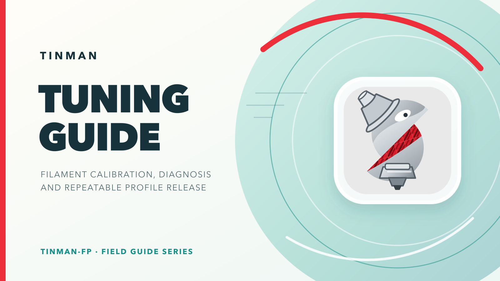
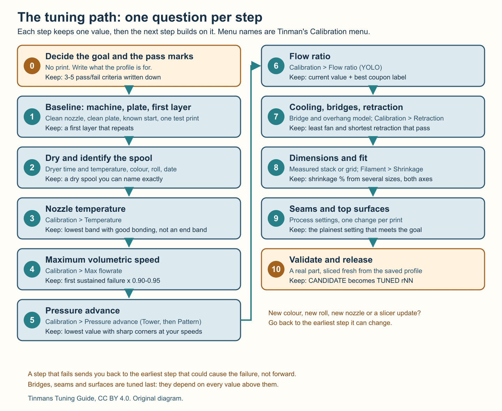

<p align="center">
  
</p>

# Tinmans Tuning Guide

A practical, evidence-based handbook for tuning FFF/FDM filament profiles,
written alongside real tuning runs on real printers.

**[Read the Tinmans Tuning Guide Wiki](https://github.com/Tinman-FP/tinmans-tuning-guide/wiki)**
· **[Download the complete linked PDF](output/pdf/Tinmans-Tuning-Guide.pdf)**

Slicer downloads:

- [Download the latest official OrcaSlicer release](https://github.com/SoftFever/OrcaSlicer/releases/latest)
- [Download public Tinman](https://github.com/Tinman-FP/Tinman/releases)

**November 2026 edition (1.1.0).** This edition is written for Tinman on its
OrcaSlicer 2.5.1 base and checked against Tinman's source on 2026-11-21. It
adds a chapter on [running Tinman's calibration tests](guide/25-running-tinman-calibrations.md)
and their traps, and [four complete worked examples](guide/26-worked-examples.md)
from PCTG, PET-CF and ABS tuning runs on a Creality K2 Plus, a Prusa CORE One+
INDX, a Qidi Plus4 and a Snapmaker U1. Several earlier statements were
corrected; see the [changelog](CHANGELOG.md). Public Tinman previews older than
the 2.5.1 base may show different dialogs; see
[Slicer Upgrades](guide/21-slicer-upgrades-and-calibration-changes.md).

This guide explains what to tune, why the order matters, how to read each test,
and how to keep enough evidence that a good profile can be reproduced instead of
rediscovered. It is written for ordinary Cartesian, CoreXY, delta, bedslinger,
direct-drive, Bowden, single-tool, and multi-tool printers. Slicer and firmware
names vary, but the physical problems are the same.

## Start Here



If the printer is mechanically sound, this is the whole process on one page.
Each step keeps one value; the next step builds on it. Follow the links for the
detail.

0. **Decide what "good enough" means.** Write three to five pass marks before
   printing anything: bonding, stringing, bridges, dimensions.
   [How](guide/00-how-to-use-this-guide.md#step-0-decide-what-good-enough-means)
1. **Prove the baseline.** Clean nozzle, clean plate, a first layer you have
   measured with calipers, and the right nozzle selected in the slicer.
   [Foundations](guide/01-foundations.md) ·
   [profile identity](guide/20-profile-integrity-and-experimental-resets.md)
2. **Dry the spool and name it.** Record how it was dried. A new roll or a new
   color is a new filament until a test print says otherwise.
   [Conditioning](guide/02-conditioning-and-temperature.md)
3. **Temperature:** **Calibration > Temperature** over the maker's range plus a
   step each way. Keep the coolest band that bonds well and is not an end
   band. [Temperature](guide/02-conditioning-and-temperature.md#run-the-tower-in-tinman)
4. **Maximum volumetric speed:** **Calibration > Max flowrate**. Keep
   `0.90-0.95` of the flow where defects start.
   [Volumetric flow](guide/03-volumetric-flow.md)
5. **Pressure advance:** a **PA Tower** to find the band, then a **PA
   Pattern** at your real speeds and accelerations. Keep the lowest value with
   sharp corners. [Pressure advance](guide/04-pressure-advance.md)
6. **Flow ratio:** **Calibration > Flow ratio > YOLO**. New value = current
   **plus** the best coupon's label. If all coupons look the same, keep the
   current value. [Flow ratio](guide/05-flow-ratio.md)
7. **Cooling, bridges, retraction:** a bridge-and-overhang model, then
   **Calibration > Retraction**, confirmed on a real part.
   [Cooling and retraction](guide/06-cooling-and-retraction.md)
8. **Dimensions:** measure frames of several sizes. Proportional error goes in
   **Shrinkage (XY)**; a constant error goes in contour compensation.
   [Dimensional accuracy](guide/07-dimensional-accuracy.md)
9. **Seams and surfaces**, one change per print.
   [Seams and surfaces](guide/08-seams-and-surfaces.md) ·
   [motion tests](guide/19-motion-diagnostics.md) if the texture depends on
   speed or direction
10. **Validate and release** on a real part sliced fresh from the saved
    profile; rename `CANDIDATE` to `TUNED`.
    [Validation](guide/09-validation.md)

**Before your first calibration in Tinman,** read the one-page
[safe recipe](guide/25-running-tinman-calibrations.md#the-safe-recipe): the
tests change the filament you last opened for editing, and their objects start
on filament 1.

A step that fails sends you back to the earliest step that could cause the
failure, not forward. When a step shows nothing (every coupon looks the same,
no strings at any length), that is a result: keep the current value and move
on.

For a symptom-first route, use the [diagnostic matrix](guide/diagnostic-matrix.md).
For unfamiliar terms, use the [glossary](guide/glossary.md). For every slicer
control, start with the [settings reference](guide/11-orca-tinmanx1-settings-reference.md).

## Five Rules That Prevent Most Tuning Mistakes

1. Verify the physical tool, nozzle, resolved profiles, and final G-code agree.
2. Change one causal variable at a time after any broad search.
3. Keep a control sample and record the complete conditions.
4. Tune extrusion quality before dimensional compensation.
5. Use the setting that matches the error model.

That fifth rule is crucial:

- Use flow ratio to correct how much material is deposited.
- Use pressure advance to correct pressure lag during speed changes.
- Use shrinkage compensation for proportional cooled-part scale error.
- Use contour or hole compensation for near-constant offsets.
- Use elephant-foot compensation only for enlarged bottom layers.
- Do not alter axis calibration to hide filament shrinkage.

## What This Guide Does Not Promise

There is no universal best temperature, flow ratio, retraction distance, or
pressure-advance value. The result depends on the exact filament, color, lot,
moisture state, nozzle, hotend, extruder, layer geometry, speed, acceleration,
cooling, and chamber conditions. The worked examples show this plainly: one
PCTG product tuned to four different temperatures, MVS values and PA values on
four printers. This guide provides a method for finding and defending a value
for a defined setup.

## Safety

- Treat hotends, beds, chambers, and freshly printed parts as burn hazards.
- Keep hands, tools, hair, and clothing clear of moving machinery.
- Follow the filament manufacturer's safety data and ventilation guidance.
- Do not leave an unproven material or profile unattended.
- Some materials release irritating or hazardous emissions. Use suitable local
  exhaust or enclosure ventilation for the material and environment.
- Dry filament only within the limits of its spool, packaging, and manufacturer.
- Wear eye protection when breaking test parts.

## Repository Contents

| File | Purpose |
| --- | --- |
| [How to use this guide](guide/00-how-to-use-this-guide.md) | Pass marks, test design, evidence, and stop rules |
| [Foundations](guide/01-foundations.md) | Mechanical, slicer, first-layer, and bed-adhesion baseline |
| [Conditioning and temperature](guide/02-conditioning-and-temperature.md) | Drying, temperature towers, a simple bond check |
| [Volumetric flow](guide/03-volumetric-flow.md) | Melt-capacity ceiling and speed conversion |
| [Pressure advance](guide/04-pressure-advance.md) | Tower, pattern, chamber effects, firmware notes |
| [Flow ratio](guide/05-flow-ratio.md) | YOLO and Pass tests, their arithmetic, feature flow |
| [Cooling and retraction](guide/06-cooling-and-retraction.md) | Cooling model, bridges, retraction towers that never string |
| [Dimensional accuracy](guide/07-dimensional-accuracy.md) | Shrinkage versus offsets, holes, elephant foot |
| [Seams and surfaces](guide/08-seams-and-surfaces.md) | Seam tests and top-surface path defects |
| [Validation](guide/09-validation.md) | Acceptance, naming, versioning, and release |
| [Material families](guide/10-material-families.md) | Material priorities with field results |
| [Settings reference and versions](guide/11-orca-tinmanx1-settings-reference.md) | Scope, version basis, and difference labels |
| [Quality tab](guide/12-quality-tab.md) | Geometry, walls, surfaces, seams, and precision |
| [Strength tab](guide/13-strength-tab.md) | Shells, infill, structural paths, and Strength Lens |
| [Speed tab](guide/14-speed-tab.md) | Feature speeds, acceleration, jerk, and transitions |
| [Support tab](guide/15-support-tab.md) | Conventional, tree, raft, and TinmanX1 Wave Overhang support |
| [Multimaterial tab](guide/16-multimaterial-tab.md) | Prime towers, assignments, purge, and interlocking |
| [Others tab](guide/17-others-tab.md) | Adhesion, special modes, output, and scripts |
| [TinmanX1 fiber and strength tools](guide/18-tinmanx1-fiber-and-strength-tools.md) | Process, filament, and machine fiber controls |
| [Motion diagnostics](guide/19-motion-diagnostics.md) | Acceleration towers, input shaping, VFA, and a worked field example |
| [Profile integrity and experimental resets](guide/20-profile-integrity-and-experimental-resets.md) | Tool/nozzle identity, false baselines, machine-specific profiles |
| [Slicer upgrades and calibration changes](guide/21-slicer-upgrades-and-calibration-changes.md) | The OrcaSlicer 2.5.1 base, Tinman changes, re-testing after updates |
| [Filament and printer settings](guide/22-filament-and-printer-settings.md) | Material identity, thermal settings, machine contracts, scripts, tools |
| [Application and project help](guide/23-application-and-project-help.md) | Profile sync, import/export, changes, and preferences |
| [3DBenchy inspection and measurement](guide/24-benchy-inspection-and-measurement.md) | Official features, nominal dimensions, and evidence-based grading |
| [Running Tinman's calibration tests](guide/25-running-tinman-calibrations.md) | Every Calibration-menu test, the safe recipe, and known issues |
| [Worked examples](guide/26-worked-examples.md) | Four complete tuning runs, wrong turns included |
| [Diagnostic matrix](guide/diagnostic-matrix.md) | Symptom-to-cause triage |
| [Glossary](guide/glossary.md) | Definitions and formulas |
| [Experiment log](templates/experiment-log.md) | Reusable test record |
| [Release checklist](templates/profile-release-checklist.md) | Final profile audit |
| [Sources](SOURCES.md) | Primary references and further reading |
| [Credits](CREDITS.md) | Attribution and authorship |
| [Complete PDF](output/pdf/Tinmans-Tuning-Guide.pdf) | Single-file publication with linked contents and cross-references |

## Evidence Standard

Every accepted value should have:

- a dated experiment record;
- the exact printer, tool, nozzle, material, and filament condition;
- the exact project or sliced G-code;
- a list of fixed variables and the one changed variable;
- photographs in a repeatable orientation, or caliper readings;
- measurements taken after the part fully cooled;
- an explicit decision: `candidate`, `accepted`, `rejected`, or `superseded`.

The [experiment template](templates/experiment-log.md) is designed for this.

## Rebuild the PDF and Wiki

The [wiki publication instructions](wiki/README.md) describe how to keep the
GitHub Wiki and Tinman's setting-help destinations synchronized with this source.

The PDF is generated from the repository's Markdown sources so the web and
single-file editions stay synchronized.

```bash
python3 -m pip install -r requirements-pdf.txt
python3 scripts/build_pdf.py
```

The finished publication is written to
`output/pdf/Tinmans-Tuning-Guide.pdf`.

## License and Attribution

The original text and diagrams in this repository are licensed under
[CC BY 4.0](LICENSE). Source projects retain their own licenses. See
[CREDITS.md](CREDITS.md) and [SOURCES.md](SOURCES.md) for attribution.

Project initiated and experimentally informed by the Tinman project's maintainer. Researched,
written, organized, and published with Codex by OpenAI; the November 2026
edition was revised with Claude by Anthropic. No source author, project, or
company listed here has endorsed this guide.
