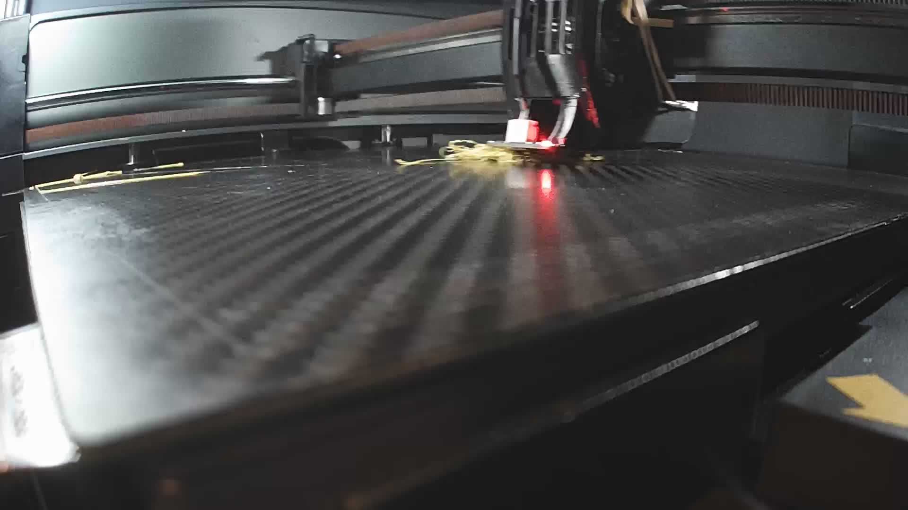
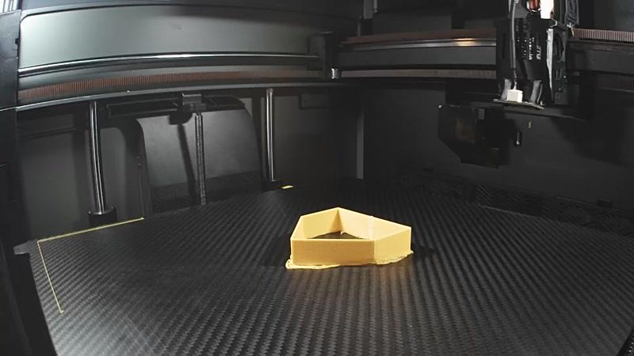

# Foundations: Establish a Trustworthy Baseline

Filament calibration cannot compensate for a loose printer, a partially
blocked nozzle, an unstable bed, or an incorrect tool offset. Prove the machine
first.

## Hardware Checklist

Inspect and record:

- nozzle diameter, material, installation, contamination, and wear;
- hotend assembly, heater, temperature sensor, and fan operation;
- extruder gear cleanliness, tension, alignment, and filament path drag;
- belts, pulleys, fasteners, rails, wheels, bearings, and lubrication;
- build plate type, flatness, attachment, cleanliness, and damage;
- part-cooling duct position and fan response;
- chamber sensors, doors, lids, and exhaust behavior;
- spool path, reverse Bowden tube, buffer, or material changer resistance.

Filled or abrasive materials can enlarge a soft nozzle. A worn nozzle changes
line geometry and may make a formerly valid profile appear over-extruded.

## Firmware and Motion Checklist

Confirm:

- X, Y, Z, and extruder motion calibration are mechanically correct;
- homing and endstop behavior are repeatable;
- bed tramming and mesh probing are valid at the intended temperature;
- the expected mesh and tool offsets are actually loaded;
- input shaping or resonance compensation is appropriate for the machine;
- acceleration and speed limits do not cause skipped steps;
- thermal protection is enabled and temperature control is stable.

Extruder rotation distance or E-steps is a machine relationship between motor
motion and commanded filament feed. Establish it with the extruder operating in
the manufacturer's supported manner. Do not retune it for every spool.

## First Layer

The first layer must be repeatable before material tuning:

- adjacent lines touch without deep ridges;
- the line adheres through corners and direction changes;
- the nozzle does not scrape the plate;
- the bottom is not so compressed that it creates a large elephant foot;
- the plate reaches a stable temperature before probing and printing.

Do not judge global flow from a first layer. First-layer height, Z offset, bed
texture, and initial-layer flow deliberately change its appearance.

## Build-Plate Preparation and Adhesion

Treat plate preparation as a controlled tuning input. A calibration tower that
releases from the plate is not valid evidence for temperature, maximum flow,
pressure advance, or flow ratio above the release point.

Record the exact plate, cleaning method, adhesive and application state, bed
temperature, first-layer controls, and brim with every calibration. If the
part moves, stop and correct adhesion before changing unrelated filament
settings.

### Tinman field result: R3Men carbon-fiber plate

On the R3Men carbon-fiber build plate used in the Tinman fleet, Vision Miner
Nano Polymer is the only bed adhesive we have found to work consistently. This
is a field result for the tested plates, materials, and procedures, not a
universal compatibility claim.

The photographed K2 Plus pressure-advance test below used dry 3D-Fuel PCTG, a
`0.6 mm` nozzle, an `85 C` bed, and the same hash-verified G-code in every run.
Three attempts released by PA `0.018`, including one after the Beacon cover was
secured and the plate had been cleaned. The failed third attempt formed the
filament nest shown here.



For the fourth attempt, the operator thoroughly washed the plate with warm
water and dish soap, rinsed and dried it, then applied a fresh coat of Vision
Miner Nano Polymer. The printer, material, profile, `5 mm` outer-only zero-gap
brim, and PA `0.016-0.048` schedule were unchanged. The tower remained attached
through PA `0.048` and completed normally.



The lesson is not that adhesive can compensate for a dirty plate. Adhesive
presence alone did not make the earlier attempts reliable. The repeatable
procedure is:

1. Let the plate reach a safe handling temperature and remove all failed-print
   residue.
2. Wash thoroughly with warm water and residue-free dish soap, rinse well, and
   dry with a clean lint-free material. Do not touch the print area afterward.
3. Apply a fresh, even Nano Polymer coating according to its product
   instructions.
4. For a small-contact calibration object, use a `5 mm` outer-only, zero-gap
   brim and verify the emitted brim actually joins the model.
5. Keep the preparation identical for confirmation and production prints, and
   log any change as an experimental variable.

Camera evidence can prove retention and completion. It cannot by itself grade
fine PA faces, surface finish, or layer strength; inspect the cooled part
physically before promoting a profile value.

## Temperature Stability and Heat Soak

High-temperature materials and large enclosed printers can change as the frame,
bed, chamber, and toolhead warm. Use the same heat-soak procedure for calibration
and production. Record either the soak time or the condition that starts the
print, such as chamber temperature and bed stability.

## Slicer Baseline

Create or duplicate a known working printer profile. Record:

- slicer name and exact version;
- firmware flavor and machine limits;
- tool and nozzle assignment;
- layer height and line widths;
- speed and acceleration by feature;
- wall generator and wall order;
- seam strategy;
- top/bottom layers and surface pattern;
- cooling and minimum-layer-time behavior;
- any start G-code that changes mesh, offsets, PA, flow, or temperature.

Calibration generators can leave temporary overrides in a project. Start a
fresh project after using them and verify the resulting G-code.

### Nozzle and profile identity gate

Do not infer nozzle diameter from the profile name. Verify the installed tool,
the printer definition, process line widths, and emitted G-code as separate
pieces of evidence. If they disagree, stop tuning and follow [Profile Integrity
and Experimental Resets](20-profile-integrity-and-experimental-resets.md).

A wrong nozzle assumption can make PA, seam, retraction, line-width, and flow
experiments appear internally consistent while every accepted number belongs
to a setup that does not physically exist.

## Filament Identity

Give each profile a precise identity:

```text
Manufacturer / product / material / color / diameter / lot / date opened
```

Colorants and additives can change flow, temperature, and cooling behavior.
Treat a different color or lot as unverified until a short confirmation print
passes.

<!-- pdf:page-break-before -->

## Baseline Acceptance Print

Before advanced tuning, print a simple artifact that includes:

- a broad wall;
- a top surface;
- a short bridge;
- an overhang;
- a seam or repeated corner;
- a known external dimension.

The purpose is not perfection. It confirms that the printer can complete a
controlled test and reveals obvious mechanical or thermal faults.

If probing, homing, nozzle condition, or tool selection is not repeatable, log
that as a machine event and suspend filament tuning. Do not count failed starts
or hardware faults as material outcomes.

Proceed to [Conditioning and Temperature](02-conditioning-and-temperature.md).
