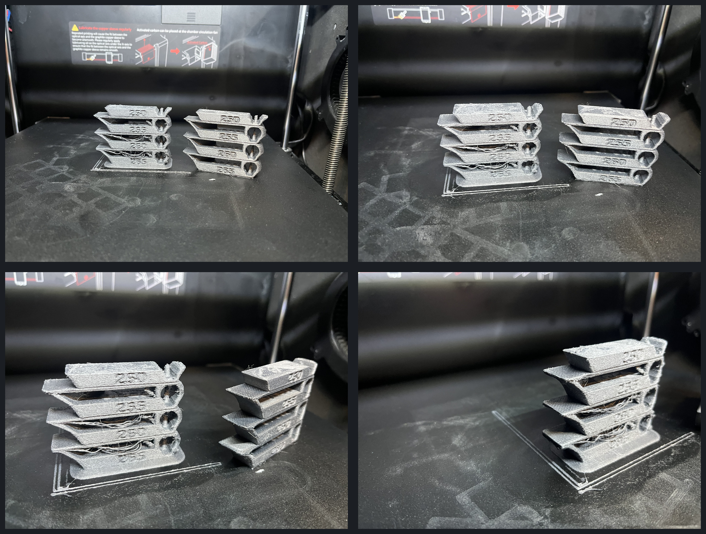

# Filament Conditioning and Temperature

Temperature tuning is meaningful only when the material condition is stable.
Water in filament can create defects that resemble poor temperature, flow,
retraction, or pressure advance. Dry the spool, name it exactly, then find the
temperature.

> **Quick path.** Dry the spool and record how. Print **Calibration >
> Temperature** over the maker's range plus one step each side. Pick the
> coolest band that still bonds well and is not an end band. Confirm it again
> at production flow in the [next chapter](03-volumetric-flow.md).

## Moisture Symptoms

Possible signs include:

- popping, crackling, or visible vapor at the nozzle;
- rough, foamy, or inconsistent extrusion;
- bubbles, pits, blobs, or smoke-like wisps;
- excessive stringing despite reasonable retraction;
- weak or brittle layers;
- an unstable surface finish from layer to layer.

These signs are not individually conclusive, but drying is the correct first
experiment when storage history is unknown.

## Drying Safely

Use the filament manufacturer's recommendation when available. Confirm that the
spool and any label, bag, RFID tag, or hub can tolerate the dryer temperature.
Prusa's drying table is a useful cross-check, not permission to exceed a product
limit.

Record:

- dryer type and measured temperature;
- drying duration;
- spool starting condition;
- time between drying and printing;
- whether the spool remained in a dry box during the test, and the box's
  humidity reading;
- when the dry box's desiccant was last renewed.

### What the Field Runs Actually Did

These are records from the guide's own tuning runs, not a schedule to copy.
They show the kind of detail worth writing down.

| Material | Conditioning recorded | What it showed |
| --- | --- | --- |
| 3D-Fuel Pro PCTG (K2 Plus) | New roll dried at about `65 C` for `6-8 h`; dry-box desiccant replaced; box read `40 %` RH just after opening | The restart that followed found stable results; earlier tests on a roll that had sat in the feeder for weeks were confounded |
| 3D-Fuel Pro PCTG (CORE One+ INDX) | New vacuum-sealed spool straight into a heated dry box; printing from a `65 C` box at `12 %` RH | Fine hairs on the first Benchy were read as temperature and retraction, not moisture |
| Elegoo PET-CF (Qidi Plus4) | `16 h` at `60 C`, then a heated dry box at `14-18 %` RH | Below the maker's `80 C / 8 h`; accepted because the storage history was known. Later whiskers proved to be geometry, not moisture |
| Elegoo PET-CF (CORE One L+) | Straight from the vacuum bag into a dry box | Treated as **undried**: a sealed bag is not proof of a dry spool |

### Treat Every New Roll and Colour as Unverified

Colorants and additives change flow, temperature, and cooling. A new roll of
the same product, or a new color, is unverified until a short confirmation
print passes. This includes a color change *within one spool*: one PCTG spool in
the field runs changed from yellow to orange halfway through. Temperature and
MVS had been set on the yellow half; pressure advance, flow, retraction, and
four cooling tests then ran on the orange half. Those later results could not
be trusted, and the run restarted from temperature.

## Controlled PET-CF Drying Comparison

The photographs below compare Elegoo PET-CF printed from the same G-code on
the same Qidi Plus 4, nozzle, settings, and room conditions. The operator
reported the left tower as undried and the right tower as dried. The dried
specimen has markedly cleaner bridges, fewer loose strands, more coherent
overhangs, and a more uniform surface. This is a controlled A/B result for one
spool and process, not a universal drying schedule.

The comparison is also a useful diagnostic warning: moisture can produce
defects that look like excessive temperature, poor retraction, weak bridging,
or unstable flow. Dry and stabilize the spool before changing several slicer
variables to chase those symptoms.

## What Nozzle Temperature Changes

Higher temperature generally lowers melt viscosity and can improve high-flow
extrusion and layer bonding. It can also increase ooze, stringing, gloss,
degradation, and loss of small-feature definition.

Lower temperature may sharpen details and reduce ooze, but can cause poor
bonding, incomplete melting, high backpressure, skipped extrusion, or a matte
under-extruded surface.

The useful temperature therefore depends on flow rate and purpose. A slow
display print and a fast structural print may need different values.

## Run the Tower in Tinman

Use **Calibration > Temperature**. Before you start, open the filament you are
tuning with its slot's edit button, as described in
[Running Tinman's Calibration Tests](25-running-tinman-calibrations.md#the-safe-recipe).

1. Pick the filament type. It fills in a default range (for example PCTG
   `280 -> 240 C`). Replace it with the maker's range, extended by one or two
   `5 C` steps where that is safe, so the best band is unlikely to be an end
   band.
2. Leave **Auto-scale for nozzle** on unless you need to compare with an older
   unscaled tower. It sizes the tower and layer height to the nozzle: `10 mm`
   bands for a `0.4 mm` nozzle, `15 mm` for `0.6 mm`.
3. After the test is built, move the tower to your filament's slot and check
   the temperature bands in the preview.

The tower prints **hottest at the bottom**, `5 C` cooler per band, with the
temperature embossed on each band. One field run read a tower upside down
before this was checked; count from the bottom.

## Design a Temperature Tower

The same rules apply to any tower, built-in or your own:

1. Begin inside the manufacturer's safe range.
2. Use steps large enough to reveal a trend, commonly `5 C`.
3. Keep layer height, width, speed, cooling, and geometry fixed.
4. Verify in G-code preview or text that temperature commands occur at the
   intended heights.
5. Label each segment in the model or experiment record.
6. Include a range above and below the expected optimum when safe.

A tower does not identify an optimum if the best section is at the hottest or
coldest tested endpoint. Extend the range in that direction.

An endpoint is not a winner merely because one face looks smoother. First
check all repeated features and exclude temperature-transition layers. Do not
extend a range when every tier retains the same unresolved failure.

## Read the Tower

Evaluate every segment for:

- consistent walls and surface finish;
- overhang edge definition and curl;
- bridge sag and strand coherence (Tinman's tower has a bridged window in
  every band);
- stringing and wisps (the hole with a cone in every band collects them);
- small-feature and text fidelity;
- corner quality and seams;
- discoloration or signs of degradation;
- layer adhesion after cooling.

Read **trends across bands**, not one band against its neighbor. Photos taken
in mixed light can make one band look better than it is; a steady rise or fall
across five bands is much more reliable.

### Worked Example: PCTG on Two Printers

The same product, 3D-Fuel Pro PCTG, was tuned on a Creality K2 Plus
(`0.6 mm` hardened nozzle) and a Prusa CORE One+ INDX (`0.4 mm` high-flow
nozzle). The maker publishes `250-280 C`.

- **K2 Plus, tower `280 -> 240 C`:** stringing and bridge sag rose steadily
  with temperature. `240 C` was nearly clean, `245-250 C` showed a few light
  wisps, and `265-280 C` had heavy webs. Every band had glossy walls, and the
  small pins were "super strong and hard to break". Selected: **`245 C`**,
  the coolest band with the required bonding that was not the end band.
  A colder tower was not run because `240 C` is already below the maker's
  minimum.
- **CORE One+ INDX, tower `270 -> 240 C`:** `260-270 C` had wavy, curled
  overhang lips and the most hairs; `250 C` had a straight lip, a clean bridge,
  and light stringing; `245 C` and `240 C` had sagging bridge strands.
  Selected: **`250 C`**.

Two well-run towers of the same filament chose different temperatures. The
nozzle, hotend, cooling, and layer height differ, so a temperature is a value
for *one setup*, not for a spool.

## A Simple Bond Check

A tower photograph cannot show layer strength. When the part matters
structurally, or when two bands look equally good, add a comparative bond
check. It ranks candidates; it does not measure strength.

1. Print the same small vertical feature at each candidate temperature: the
   tower's pins, or a separate bar about `10 x 5 x 45 mm` printed upright, one
   temperature per print.
2. Let the parts cool fully. Wear eye protection.
3. Break each one the same way: the same grip, the same direction, the same
   distance from the base.
4. Record how it failed. A part that bends or turns white before breaking, with
   a rough break, bonds better than one that snaps flat along a single layer.

**Watch which layers you are testing.** A small pin next to large, slow layers
prints at whatever fan speed those large layers set. In one cooling run the pin
broke cleanly in two prints with different fan limits, because on the layers
where it broke both prints were running at the same minimum fan. A
"pins only" model, where every layer is short and the fan limit actually
applies, gave a clear answer: all three pins bent before breaking. The same
caution applies to a tower's pins: they report the bonding of their own band's
conditions.

In another run, a pin tore out of its base in one print and broke cleanly in
the next, from identical G-code. A check that does not repeat cannot measure
bonding; do not build a decision on it.

### When Every Temperature Retains the Defect

This Qidi Plus4 / CM2 0.6 mm / Elegoo PET-CF example used stock-size native
geometry, 0.24 mm body layers, 0.30 mm first layer, flow 1.00, PA 0,
3 mm3/s diagnostic cap, 100 C bed and 50 C chamber target. Main cooling was
20% after the first three layers. The five body bands occupied layers
2-42, 43-84, 85-125, 126-167 and 168-208, respectively, not fixed 25-layer
steps. Reported temperatures followed the commands after transitions, but
fine tracks remained defective across the range. Height, time and repeated
feature geometry remain confounds; no temperature was accepted from this test.

The cause turned out to be below the filament. A later audit found first-layer
coupons sliced at `0.30 mm` measuring `0.45-0.66 mm`, and traced it to plastic
left on the nozzle after the purge, which made the probe set zero `0.3-0.4 mm`
too high. Once that foundation was fixed (see
[Foundations](01-foundations.md#repeatable-is-not-the-same-as-correct)), the
same filament gave a clear temperature result.

Do not turn a generic moisture symptom list into a diagnosis. Wet filament
can cause roughness, pits, inconsistent extrusion and stringing, but those
observations overlap with delivery, toolpath and thermal/cooling faults.
Organized bands or defects that recur at the same feature transitions warrant
mapping to the emitted paths, layer timing, speed/width/flow and retract/restart
events. A sensor near the heater does not measure melt throughput, and an
upstream diameter sensor does not measure deposited volume.

Record actual conditioning history before deciding whether a drying A/B is
informative. A recipe mismatch alone does not prove the defects are
moisture-caused. The [Elegoo PET-CF specification](https://www.elegoo.com/products/pet-cf),
reviewed 2026-10-22, gives 80 +/- 5 C for 8 hours, with drying before use.
Only use that schedule in a dryer and spool rated for it; do not defeat
temperature limits. A documented conditioning comparison can test a moisture
hypothesis, but a negative result must redirect diagnosis rather than trigger
endless drying or temperature sweeps.

If no tier resolves the failure, stop the sweep. Audit the exact failed paths
and the machine/deposition baseline, then define a small, controlled test with
an explicit discriminating outcome. Do not advance automatically to MVS, PA,
flow or cosmetic retraction tuning. This is a return to the earliest affected
prerequisite, not a requirement to repeat every previously valid check.

## Selection Rule

Choose the lowest temperature that provides the required adhesion and stable
flow at the intended production rate, unless a hotter setting produces a
materially better mechanical result with acceptable detail and stringing.

Two boundaries apply:

- **The best band must not be an end band.** If it is the hottest band, extend
  hotter within the material's limits. If it is the coolest, extend cooler.
- **The maker's minimum is a boundary, not a target.** If your best band is at
  or below the published minimum, do not extend colder. Confirm bonding with
  the bond check instead, and note in the profile that it runs below the
  published range.

For high-flow work, confirm the selected temperature again during the
volumetric-flow test. A visually good low-speed tower section may not melt fast
enough for production.

### Preserve Margin Above a Cold-Flow Failure

The dried Elegoo PET-CF tower below ran from `265 C` at the bottom through
`260 C`, `255 C`, and `250 C`. Two attempts stopped at approximately the same
point as the program moved toward the next, colder step. After cancellation,
the same filament path extruded `300 mm` normally after the nozzle was heated
to `300 C`. That result is consistent with insufficient melt capacity at the
low-temperature endpoint rather than a persistent clog.

**Correction (November 2026).** An earlier edition chose `255 C` from this
tower. That selection is withdrawn. Later work on the same printer replaced
part of the filament path, found the first-layer fault described above, and
an owner pin-break check rated `260 C` weak and `265 C` and hotter strong. After
the foundation was fixed, a new tower on the same printer and `0.6 mm` nozzle
showed `260 C` failing, `265 C` marginal, and `270-285 C` equal. The tuned
profile uses **`275 C`**, `10 C` above the failure and inside Elegoo's
published `260-290 C` range.

The lesson that survives is the margin rule: keep at least one full step above
a repeatable loss-of-flow or loss-of-bonding boundary, and confirm the choice
at the intended production volumetric flow.

## First-Layer Temperature

A hotter first layer can improve wetting and reliability, but it is a separate
setting from normal-layer temperature. Excess heat can increase ooze, elephant
foot, or polymer degradation. Tune it only after Z offset and plate preparation
are correct.

## Common Misreads

| Observation | Do not assume | Check |
| --- | --- | --- |
| Stringing | temperature is too high | moisture, travel, retraction, nozzle residue |
| Matte upper tower | temperature is too low | whether flow rate also increases with height |
| Weak bridge | temperature alone is wrong | bridge fan, speed, flow, line width |
| Rough surface | over-extrusion | wet filament, partial clog, unstable temperature |
| Best result at endpoint | endpoint is optimum | extend the range safely |
| Best band below the maker's range | colder is still better | bonding, with the bond check; do not extend colder |
| Same defect in every band | temperature is the cause | first layer, probe, nozzle, toolpath |
| Tower looks upside down | the generator is wrong | Tinman prints hottest at the bottom |

Once temperature is bracketed, find the system's usable
[volumetric-flow limit](03-volumetric-flow.md).
