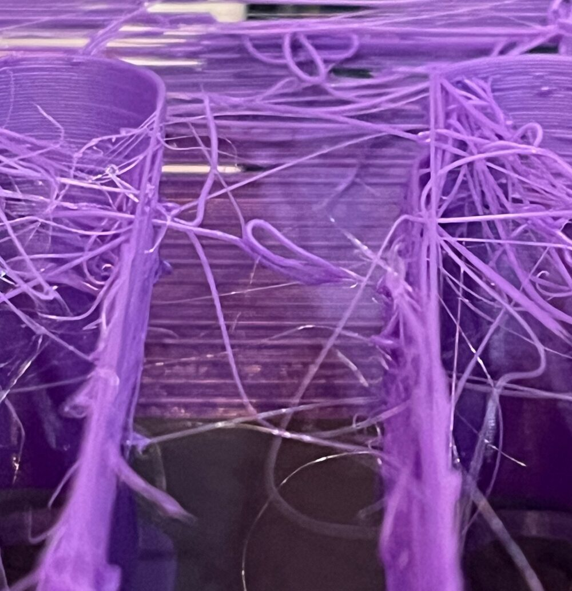

# Maximum Volumetric Flow

Maximum volumetric speed (MVS) is the amount of plastic the complete extrusion
system can melt and deposit per second under defined conditions. It is not a
universal hotend specification. Filament, temperature, nozzle geometry,
extruder grip, and cooling all affect the result.

> **Quick path.** Run **Calibration > Max flowrate** at your chosen
> temperature, with a range that goes past where you expect failure. Measure
> the height where defects start, convert it to flow, and set the filament's
> **Max volumetric speed** to `0.90-0.95` of that flow.

## The Basic Equation

For a straight extruded path:

```text
volumetric flow (mm^3/s) = speed (mm/s) * line width (mm) * layer height (mm)
```

Rearranged:

```text
maximum speed = maximum volumetric flow / (line width * layer height)
```

Example:

```text
MVS = 15 mm^3/s
line width = 0.45 mm
layer height = 0.20 mm
maximum steady extrusion speed = 15 / (0.45 * 0.20) = 166.7 mm/s
```

The machine may still be limited by acceleration, motion, minimum layer time,
or feature-specific speed.

## Why Tune MVS Before Flow Ratio

A flow-ratio test printed beyond the melt limit can look under-extruded even
when the ratio is correct. Establish a safe throughput region first so later
tests evaluate the requested setting rather than hotend saturation. Tinman's
flow-ratio and pressure-advance tests also size their speeds from the
filament's MVS, so a credible MVS makes those tests credible.

## Run the Ramp in Tinman

Use **Calibration > Max flowrate**. Before you start, open the filament you are
tuning with its slot's edit button
([why](25-running-tinman-calibrations.md#the-safe-recipe)).

1. Set **Start**, **End** and **Step** in `mm³/s`. The default `5 -> 20` is too
   low for most modern hotends. Choose an end well past your expected limit;
   the field runs used `10 -> 30` on a `0.4 mm` high-flow nozzle and
   `20 -> 45` on a `0.6 mm` nozzle.
2. Tinman builds a single-wall spiral (vase) part, `1.75 x` the nozzle wide and
   `0.8 x` the nozzle high per layer, and raises the wall speed with height.
3. Move the part to your filament's slot, slice, and check the preview's flow
   or speed legend: it must rise all the way to the top.

The requested flow at a height `h` in millimetres is:

```text
flow (mm^3/s) = start + step * h
```

For a `10 -> 30` ramp with step `0.5`, a defect starting at `21 mm` means
`10 + 0.5 * 21 = 20.5 mm³/s`.

### If the Ramp Goes Flat

The test raises the MVS of the filament **open for editing** to at least
`200 mm³/s` so the ramp is not limited. If a different filament prints the
part, that filament's own MVS still caps the speed, and the upper part of the
ramp prints at one flat value. A K2 Plus ramp requested `20 -> 45 mm³/s` but
printed flat at `32` above mid-height for exactly this reason. Opening the
printing slot's filament first fixed it: the same test then printed
`20.7 -> 46.1 mm³/s`.

After the test, that filament still shows the raised MVS as an unsaved change.
Do not save it.

## Read the Ramp

Print while watching for the first **sustained** change. Failure evidence
includes:

- matte or changed gloss that persists;
- thin, rough, or discontinuous lines;
- gaps between walls, often on the straight sides first;
- missing material after acceleration;
- extruder clicking, skipping, or filament grinding;
- a sudden loss of layer adhesion;
- inability to hold nozzle temperature under load.

Ignore a single isolated blemish. Select the start of a sustained trend.
Measure its height with calipers after the part cools, on more than one side.
Report a range when the sides disagree; on one ramp the onset ran from `29 mm`
at the prong tips to `37 mm` on the outer walls, so the earliest height decided
the limit.

## Know Which Signal Ended the Test

Write down what actually stopped the ramp. They lead to different decisions.

| What happened | What it means | What to do |
| --- | --- | --- |
| Visible defects from a certain height | The melt limit at this temperature | Profile MVS = onset flow x `0.90-0.95` |
| The printer stopped or warned (for example a "stuck filament" or extruder warning) | A firmware or sensor limit, which may sit below or above the melt limit | Treat the warning height as the ceiling; `0.90` of it is a safe MVS. Note the cause in the profile |
| No defect anywhere in the range | The limit is *at least* the top of the range | Either extend the range, or set MVS to `0.90` of the top and label it "not reached" |
| Defects everywhere, even at the bottom | Not an MVS result | Go back: temperature, nozzle, first layer, wet filament, feed path |

A ramp that never failed is a floor, not a measurement. On a Qidi Plus4 with
PET-CF, nothing failed up to `21 mm³/s`; the profile records `19` as a safe
value, while the real limit is unknown. That is fine for a profile whose
fastest feature needs about `8 mm³/s`.

<!-- pdf:page-break-before -->

## Field Results

| Printer and nozzle | Filament, temperature | Ramp | What ended it | Profile MVS |
| --- | --- | --- | --- | --- |
| Creality K2 Plus, `0.6 mm` hardened | 3D-Fuel Pro PCTG, `245 C` | `20 -> 45`, step `0.5` | visible onset `34.5-38.5 mm³/s` | `32` (7 % under the earliest onset) |
| Prusa CORE One+ INDX, `0.4 mm` high-flow | 3D-Fuel Pro PCTG, `250 C` | `10 -> 30`, step `0.5` | gaps on straight walls from `21 mm` = `20.5 mm³/s` | `19` (93 %) |
| Prusa CORE One L+, `0.6 mm` high-flow | 3D-Fuel Pro PCTG, `250 C` | printed ramp | firmware stuck-filament warning near `30 mm³/s` | `27` (90 %) |
| Snapmaker U1, `0.4 mm` | Push Plastic ABS, `240 C` | `8 -> 30` | no defect to `31 mm³/s` | `26` (floor) |
| Qidi Plus4, `0.6 mm` | Elegoo PET-CF, `275 C` | custom `2 -> 21` | no defect to `21 mm³/s` | `19` (floor) |



Two lessons stand out. First, the same filament gave `19` on one printer and
`32` on another: MVS belongs to the hotend and nozzle as much as to the
filament. Second, an early, undried K2 test at `280 C` reached about
`63 mm³/s`; the dried spool at `245 C` reached about `35`. A value measured at
another temperature or moisture state does not transfer.

## Gravimetric Extrusion Method

An optional bench method commands a known filament length at increasing rates,
weighs the output, and compares actual mass with expected mass. This can reveal
gradual flow drop-off before obvious print failure. It requires a reliable scale,
known filament density or a consistent reference mass, safe collection of hot
extrudate, and careful control of temperature and timing.

The printed-ramp method is simpler and includes motion and deposited-line
behavior. The gravimetric method is useful for comparing hotends or diagnosing
the extrusion system itself. Do not treat the two results as interchangeable.

## Set a Production Limit

For a general-quality profile, set the slicer MVS below the first sustained
quality loss. A practical starting margin is `5-10%`:

```text
profile MVS = observed onset * 0.90 to 0.95
```

Use a larger margin for structural parts, long jobs, variable ambient
conditions, or spools with inconsistent diameter. A speed-focused infill
profile may accept more risk than an external-wall profile, but the tradeoff
must be explicit.

Enter the value in the filament settings: **Filament > Volumetric speed
limitation > Max volumetric speed**. It cannot be zero.

## Retest When These Change

- filament material, formulation, color, or moisture state;
- nozzle diameter, material, geometry, or wear;
- hotend, heater, heatbreak, or extruder;
- nozzle temperature;
- high-flow insert or nozzle;
- substantial layer-height or line-width regime;
- unusual backpressure from filled, flexible, or highly viscous material.

## Strength Is a Separate Limit

The highest flow that looks continuous may not produce the strongest layer
bond. If the part is structural, compare strength at the intended production
flow and at a slower control (see [the bond check](02-conditioning-and-temperature.md#a-simple-bond-check)).
Surface appearance alone does not establish melt quality throughout the bead.

With a safe flow envelope established, tune
[pressure advance](04-pressure-advance.md).
