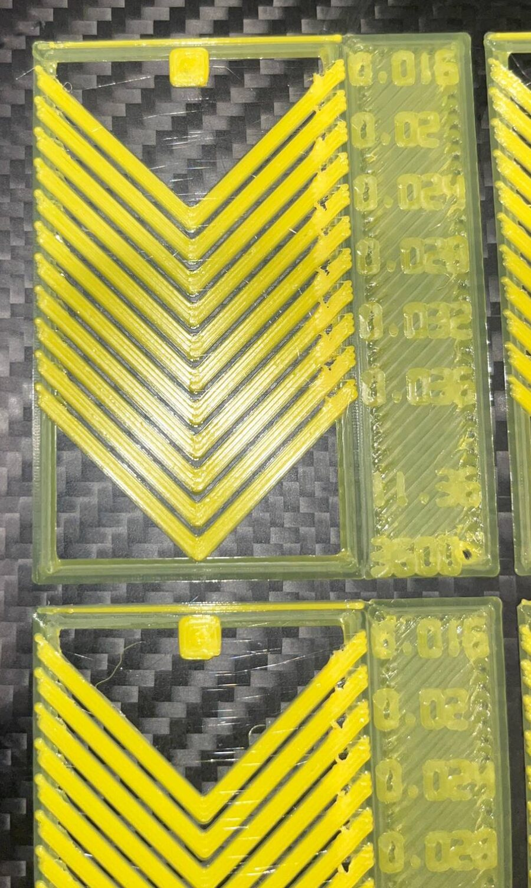

# Pressure Advance and Linear Advance

Molten polymer, filament, Bowden tubes, and the extrusion path behave like a
spring-damper system. When toolhead speed changes, nozzle pressure does not
change instantly. Pressure advance (PA) compensates for that lag by adjusting
extruder motion around acceleration and deceleration.

> **Quick path.** Print a **PA Tower** over a wide range to find the useful
> band. Then print a **PA Pattern** across that band at your real production
> speeds and accelerations. Choose the lowest value that gives sharp corners
> and full lines in every pattern.

Common names include:

- Pressure Advance in Klipper and RepRapFirmware;
- Linear Advance or K-factor in Marlin;
- flow dynamics or similar vendor-specific terms.

The values are not portable between algorithms, firmware families, or even
printers. The guide's field runs recorded `0.026` (K2 Plus), `0.035` (CORE One
L+), `0.055` (CORE One+ INDX), `0.032` (Qidi Plus4, PCTG), `0` (Qidi Plus4,
PET-CF), and `0.150` (Sovol SV08 Max). Compare a value only with earlier values
from the same printer and hotend.

## What PA Can and Cannot Fix

Correct PA can reduce:

- bulging at corners and line ends;
- thin starts after acceleration;
- pressure-related seam blobs or gaps;
- inconsistent width during speed transitions.

PA does not correct:

- the total amount of material commanded;
- wet filament;
- a partial clog;
- backlash, loose belts, or resonance;
- a wrong dimensional scale;
- poor cooling or unsupported geometry.

## Prerequisites

Before testing:

- settle temperature;
- stay below the safe MVS ceiling;
- use a mechanically sound extruder and nozzle;
- disable conflicting slicer pressure tricks where the firmware documentation
  requires it;
- choose representative speed and acceleration;
- confirm which firmware or slicer owns the active PA value;
- put the chamber in its production state (doors, lid, vents, chamber fans,
  heater), and keep it there for the whole test.

## Test Methods

Tinman's **Calibration > Pressure advance** offers three methods. Pick the
extruder type first (**DDE** for direct drive, **Bowden**); it sets sensible
default ranges. The fields and formulas are in
[Running Tinman's Calibration Tests](25-running-tinman-calibrations.md#pressure-advance).

### PA Tower: find the band

A hollow two-wall tower in which PA rises by one step per millimetre of height.
It shows repeated corners and does not depend on the first layer. Use it first,
over a wide range (the default `0 -> 0.1` in `0.002` steps suits most direct
drives), to find where corners turn from swollen to sharp to starved.

PA at a height `h` mm above the first layer is about:

```text
PA = start + step * h
```

Tinman also writes the value of each band into the G-code as a comment; use it
to settle a borderline reading. Read the corners away from the seam.

The tower prints its walls fast, from the filament's MVS. That is good for
seeing PA, but it is one speed and one acceleration, and it may not be yours.

### PA Pattern: choose the value at production conditions

A set of chevrons for each combination of speed and acceleration you list,
with every other PA value printed beside the lines. Enter your profile's real
outer-wall, inner-wall and infill speeds, and its accelerations. Print it over
the narrow band the tower found, in small steps.

On a Creality K2 Plus with PCTG, a tower printed with its walls forced to
`100 mm/s` suggested `0.032` was too high and chose `0.022-0.026`. A PA Pattern
from `0.016` to `0.036` at the production speeds `33`, `62` and `82 mm/s` and
accelerations `1200` and `3600 mm/s²` showed no too-high sign anywhere up to
`0.036`, rounded tips below `0.022` at the fastest speed, and matching tips
from about `0.026`. The pattern at production conditions decided: `0.026`.



### PA Line: quick, first-layer only

Rows of slow-fast-slow lines on the first layers, labelled if **Print numbers**
is ticked. It is fast and uses little material, but it depends heavily on
first-layer quality and the bed mesh.

### Adaptive PA

Tinman's filament settings include adaptive PA (beta), which models PA across
flow and acceleration. It needs firmware that can change PA quickly and a good
fixed PA as a starting point. On Prusa's Buddy firmware every PA change waits
for the motion planner to empty, so a PA change per feature can stall motion;
the INDX run kept a single fixed value for this reason.

## Read the Result

| Appearance | Likely interpretation |
| --- | --- |
| Corner protrudes or remains swollen; tip of a chevron rounded | PA too low |
| Line becomes thin before or after speed change; gap at the chevron tip | PA too high |
| Corner is sharp with continuous adjacent line | useful region |
| Only layer-change corner is damaged | seam/retraction contamination; read other corners |
| All values look poor | wrong range, flow saturation, mechanical problem, or wet filament |
| All values look the same | the test conditions do not show PA; see below |

Klipper specifically advises ignoring the corner with the seam when reading its
tower. When several values are equally good, choose the lower acceptable value;
excessive PA can create subtle starvation and demands more extruder response.

### When Nothing Changes

If corners look the same from the bottom to the top of a wide tower, at speeds
at or above your production speeds, the honest answer is the lowest value. On a
Qidi Plus4 with PET-CF and slow production walls, a `0 -> 0.080` tower showed
no difference, and the profile uses PA `0`. Write down the speeds and
accelerations it was tested at, and test again if you raise them.

### Lighting and Photographs

Glossy filament and mixed light can make one part of a pattern look better
than another. On the K2 pattern above, lighting changed across the plate in the
same direction as the PA values. Photograph under even, diffuse light, turn the
part and compare again, and do not claim more precision than the photographs
support: "about `0.026`" is honest; "`0.025` exactly" usually is not.

<!-- pdf:page-break-before -->

## The Chamber Changes PA

On a Prusa CORE One+ INDX, three PA towers of the same PCTG read differently:

- the first tower: `0.062` at the front corner, `0.068` at the back;
- a narrow retest: corners clean at different heights, `0.052-0.065`, with a
  faint horizontal line partway up;
- a tower with the chamber pre-warmed and its fans held off: a clean, single
  reading of `0.055` and no line.

The printer's chamber fans had started partway through the first towers, once
the chamber passed its target temperature. Every corner changed at that moment.
A tall tower made it visible; a test printed at bed level would never have
shown it.

Record the chamber state with every PA reading, warm the chamber before you
start if production prints run warm, and read a tower only within one
condition.

## Firmware Notes

- **Klipper:** `SET_PRESSURE_ADVANCE`. A PA Pattern ends with the last value it
  tested still active. The next job's start code normally sets PA again; if
  yours does not, add a reset to the end G-code. One U1 run added it.
- **Marlin:** `M900 K`. Values from a Klipper machine do not transfer.
- **Prusa Buddy:** `M572` or `M900 K`. Each change synchronizes the planner.
- **Printer-side calibration:** some printers run their own pressure or flow
  calibration at the start of a job, which can replace the slicer's values. A
  K2 Plus job started from the touchscreen ran Creality's pre-print
  calibration and printed its first layer at a different PA and flow. Start
  calibration prints from Tinman with the printer's own auto-calibration off,
  and check the first layer's commands.

## Dependence on Print Conditions

PA can change with:

- material and moisture;
- temperature and volumetric flow;
- nozzle and hotend;
- direct-drive versus Bowden path;
- acceleration and requested speed;
- chamber temperature and airflow;
- flexible or highly compressible filament.

Retest after a meaningful upstream change. If a production profile spans a very
wide flow and acceleration range, validate the compromise at slow external
walls and fast internal features.

Enter the result in **Filament > Flow ratio and Pressure Advance**: tick
**Enable pressure advance** and set **Pressure advance**. Some printer profiles
set PA from the filament's start G-code instead; check which one your printer
uses before trusting the field.

## Do Not Judge PA by the Seam Alone

Seam placement, retraction, wipe, travel distance, ooze, and layer change can
hide an otherwise correct PA value. Use non-seam corners for the initial PA
decision, then return to seam tuning later.

Next, tune [global flow ratio](05-flow-ratio.md).
