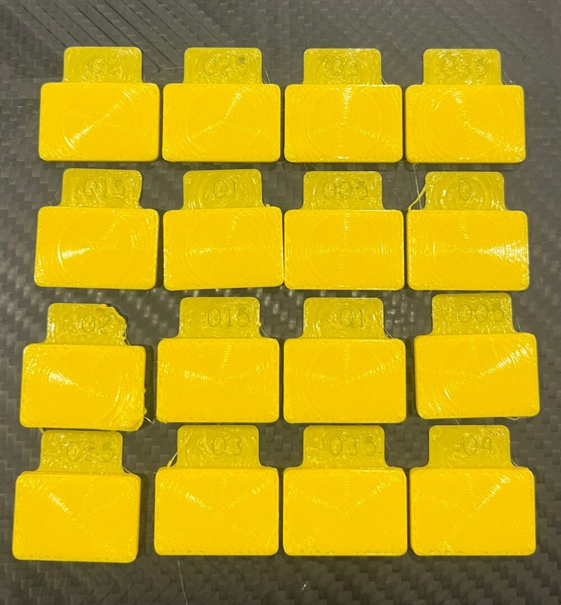

# Global and Feature-Specific Flow

> **At a glance**
> - **Decide:** the global flow ratio
> - **Test:** **Calibration > Flow ratio > YOLO (Recommended)**
> - **Keep:** current value **plus** the best coupon's label; unchanged if every coupon looks the same

Flow ratio, also called extrusion multiplier, scales the amount of material the
slicer commands. Tune it for continuous, well-formed extrusion. Do not use it
as a general dimensional correction.

## Global Flow Versus Volumetric Flow

These are different controls:

- **Flow ratio** scales commanded material, such as 0.98 for 98%.
- **Maximum volumetric flow** limits how quickly material is requested.

A correct flow ratio can still fail above the hotend's melt capacity. A low MVS
cannot repair an incorrect flow ratio; it only keeps requests inside a safer
rate.

## Run the Coupons in Tinman

Use **Calibration > Flow ratio**. Open the filament you are tuning with its
slot's edit button first, then move all coupons to that slot after the test
is built ([why](25-running-tinman-calibrations.md#the-safe-recipe)). Each
coupon is a small block with a broad top surface and its label embossed on a
tab.

The dialog offers four tests. **Their arithmetic differs**, and the dialog
does not say which one applies:

| Test type | Labels | New flow ratio |
| --- | --- | --- |
| **YOLO (Recommended)** | -0.05 to +0.05, steps of 0.01 | current **+** label |
| **YOLO (Perfectionist)** | -0.040 to +0.035, steps of 0.005 | current **+** label |
| **Pass 1 (Coarse)** | -20 to +20, steps of 5 (percent) | current **x** (100 + label) / 100 |
| **Pass 2 (Fine)** | 0 to -9, steps of 1 (percent), run after Pass 1 | current **x** (100 + label) / 100 |

Examples, starting from a current flow ratio of 0.98:

```text
YOLO, best coupon +0.02:     0.98 + 0.02         = 1.00
Pass 1, best coupon +5:      0.98 * 105 / 100    = 1.029
```

For the YOLO tests, "current" is the flow ratio of the filament open for
editing when the test was built. If the coupons then print from a different
filament, every coupon's flow comes out wrong, and the labels can even seem to
*multiply* instead of add. (Pass 1 and Pass 2 coupons simply scale the flow
ratio of whichever filament prints them.) On a Snapmaker U1 run, YOLO coupons printed at `0.95 x (1 + label)`
rather than `0.95 + label`. That is exactly what Tinman produces when the
filament open for editing has a flow of 1.00 and the printing filament has
0.95. If coupons do not match the arithmetic above, check which filament was
open and which one printed.

One K2 Plus run recorded a YOLO choice as "x 0.975". The next test showed the
coupons had printed at "current + label", and the profile value was corrected
by 0.0007. Small here, but the same mistake on a Pass test could be several
percent.

## Read the Coupons

A useful visual test has:

- enough bottom layers and infill to support the top;
- several top layers;
- a broad region with long, parallel or concentric top lines;
- known top line width and moderate speed;
- enough perimeter distance to reveal wall-interface behavior.

Inspect under glancing light, from more than one direction. Touch helps if you
can judge it; calipers and photographs work too.

### Too low

- open channels or dark valleys between lines;
- pinholes or incomplete closure;
- top lines separate from the perimeter;
- roughness caused by unsupported strands;
- weak, easily separated walls when other causes are excluded.

### Useful region

- continuous lines with no broad open channels;
- an even surface;
- clean contact with perimeter walls;
- no repeated nozzle plowing or material pileup.

### Too high

- raised ridges that catch a fingernail;
- a raised ring where an Archimedean spiral meets the corners;
- nozzle scars or plowing;
- material accumulating at line ends and walls;
- rough, overfilled corners;
- dimensional swelling across otherwise simple features.


A rule that worked well on the Archimedean-chord coupons: choose the
**highest flow before the raised ring appears**.



### Grading Without Touch

Not everyone can judge surfaces by fingertip. Two alternatives worked in the
field runs:

- **Calipers.** Measure each coupon's height and width at the same points.
  On a Qidi PET-CF run, a first set showed the top surface still open at
  0.96–0.98 and closing toward 1.04. A second set from 1.02 to 1.10
  measured 3.63–3.69 mm high and 30.11–30.27 mm wide: the parts kept
  growing with flow after the top had closed. 1.04 was kept and confirmed on
  a fresh patch.
- **Photographs** under raking light, with the coupon labels in frame, taken
  from two directions. Lighting can follow position on the plate rather than
  the label; turn the plate and compare again.

### When Every Coupon Looks the Same

Two runs printed a full YOLO set and could not tell the coupons apart: every
coupon felt the same, slightly rough on one printer. That is a
result: the flow ratio is already inside the useful region and this test
cannot resolve it further. Keep the current value. Remaining roughness that
does not change with flow belongs to the top-surface pattern, speed, or line
width ([Seams and Surfaces](08-seams-and-surfaces.md)), not to flow.

### When the Best Coupon Is at the End

If the smoothest coupon is the first or last of the range, the optimum may lie
outside it. Run the test again centred on that coupon. A U1 ABS run picked the
-0.05 coupon, re-ran YOLO around the new value, and confirmed it.

## A Sanity Bound

Most well-set-up printers with a correct filament diameter land between about
0.90 and 1.05. A result outside that window is a reason to check the
foundations before accepting it: first-layer height, Z offset, filament
diameter, extruder calibration, nozzle size. One PET-CF profile carried a flow
of 1.137 for weeks; the real cause was a first layer printing far thicker
than commanded. After the foundation was fixed the same filament tuned to
1.04.

## Coarse and Fine Passes

Whichever test you use, the method is the same:

1. Start from a sane material profile.
2. Compare broad changes, often 1–2%, to locate the useful region.
3. Refine around the best result in 0.5% steps when needed.
4. Confirm on a fresh specimen.

## Measured Single-Wall Methods

Prusa documents a vase-wall measurement method. It can work with a suitable
micrometer and controlled geometry, but ordinary calipers, rounded beads,
corner pressure, wall flex, and slicer line-width models can introduce large
relative error. Ellis' guide cautions against treating a single extruded wall
as an exact rectangular bead.

Policy for this guide:

- prefer a top-surface coupon test for routine flow tuning;
- use measured mass or carefully designed walls when the experiment calls for
  them and the uncertainty is understood;
- solve dimensions with dimensional tests, not a wall-flow shortcut.

## Feature-Specific Flow

If walls and general extrusion are correct but one feature is deficient, use a
feature-specific control where available:

- top or bottom solid infill flow;
- bridge flow;
- internal solid-infill flow;
- support-interface flow;
- first-layer flow.

Effective feature flow is multiplicative:

```text
effective top flow = global filament flow * top-surface flow ratio
```

Example:

```text
global flow = 0.98
top flow = 1.04
effective top flow = 0.98 * 1.04 = 1.0192
```

This deposits 1.92% more than nominal on top surfaces while leaving walls at
the accepted global ratio. Tinman's flow coupons reset the top-surface flow
ratio to 1.0 while testing, so a coupon result is a *global* value.

Enter the global result in **Filament > Flow ratio and Pressure Advance >
Flow ratio**. Its tooltip suggests 0.95–1.05 as the usual range.

## First-Layer and Top-Surface Traps

A rough top can originate below the visible layer. Check:

- insufficient top-shell thickness;
- sparse or poorly supported infill;
- pillowing from heat and inadequate cooling;
- warped lower layers;
- first-layer over-compression carried through a thin object;
- an unsuitable top pattern, speed, or line width.

Do not raise global flow if only the top skin is deficient and the walls,
dimensions, and other solid layers are correct.

Continue with [Cooling and Retraction](06-cooling-and-retraction.md).
