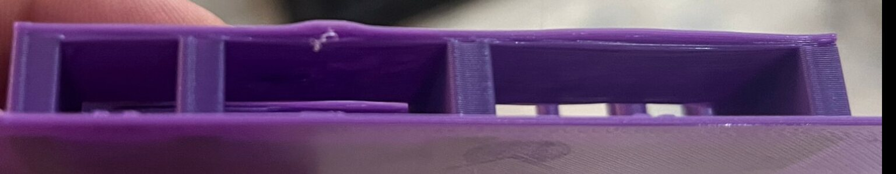
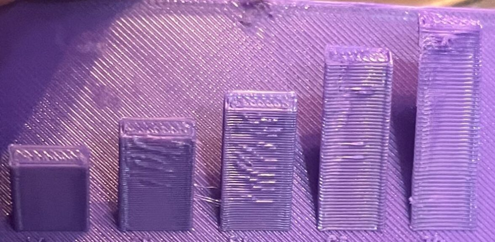
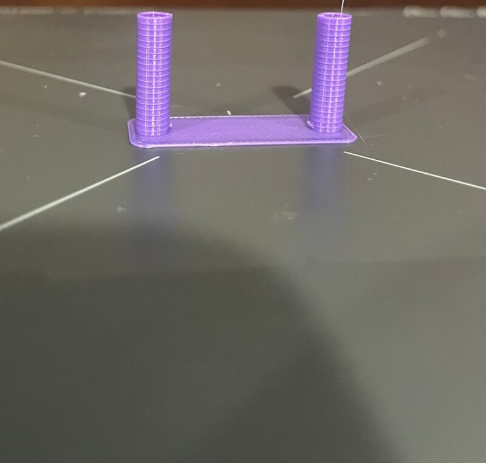

# Cooling, Bridges, Retraction, and Travel

> **At a glance**
> - **Decide:** fan speeds, bridge settings and retraction length
> - **Test:** a bridge-and-overhang model, then **Calibration > Retraction**, then a real part
> - **Keep:** the least fan that passes, and the shortest clean retraction confirmed on real travels

Cooling and retraction both affect strings and small features, but they solve
different physical problems. Tune cooling first for deposited geometry, then
use retraction and travel controls for pressure and ooze during non-print moves.

This step comes after temperature, MVS, pressure advance and flow are settled.
One field run tuned bridges and cooling first, on top of an unfinished
temperature step, and spent four prints without progress before restarting
from temperature.

## Cooling Is a Tradeoff

More part cooling can improve:

- overhang definition;
- short bridges;
- small features and minimum-layer-time behavior;
- resistance to curl on newly deposited edges.

Too much cooling can cause:

- weak layer bonding;
- warping or cracking;
- inconsistent shrinkage;
- poor chamber stability;
- nozzle-temperature droop when airflow strikes the heater block.

Use the least cooling that delivers the required geometry and strength.

## Separate Fan Roles

Printers may have several fans:

- hotend heatsink fan;
- part-cooling fan;
- auxiliary or side fan;
- chamber circulation fan;
- chamber exhaust fan.

Do not treat them as one percentage. An auxiliary fan can create a directional
surface difference or warping that the main part fan does not. Tinman's
filament **Cooling** page holds the part-fan minimum and maximum (each with a
layer-time threshold), **Overhangs and external bridges fan speed** with its
activation threshold, internal-bridge and support-interface fan speeds, and the
auxiliary and exhaust fans.

## Cooling Test Method

Tinman has no built-in cooling or bridge test. The field runs shared one simple
model that works well: a 100 × 90 mm plate with

- bridges of 10, 20, 30 and 40 mm under a deck at least 2 mm thick;
- overhang fins at 30, 45, 55, 65 and 70 degrees;
- small pins: 3 mm round, 5 mm round and 5 mm square, 20 mm tall.

Hold temperature, flow, and speed constant. Change one fan setting per print,
as a project-only change, until a value passes.

Evaluate:

- overhang edge curl and underside shape;
- bridge sag, strand separation, and anchoring;
- the top of each bridge deck (a deck thinner than about 2 mm cannot show
  whether the bridge spoiled the surface above it);
- small-feature deformation;
- layer adhesion after cooling;
- directional differences between faces;
- warping, lifting, or inter-layer cracks.

High-shrink materials should be tested in the same enclosure and chamber state
used for production.

### Field Results with the Same Model

| Printer, filament | Change | Result |
| --- | --- | --- |
| K2 Plus, PCTG, 0.6 mm | overhang and bridge fan 40 → 80 % | the 40 mm deck top closed; spans still sagged; fins unchanged |
| K2 Plus, PCTG | bridge flow 1.0 → 0.85 | no visible change |
| K2 Plus, PCTG | chamber heater off | no gain |
| CORE One+ INDX, PCTG, 0.4 mm | bridge fan 90 % | 10–40 mm bridges pass; overhangs clean to 65 degrees |
| CORE One+ INDX, PCTG | normal fan maximum 40 → 15 % | geometry unchanged; pins bend before breaking |
| U1, Push ABS, 0.4 mm | overhang and bridge fan 45 → 70 % | 70 degree fins print full height |
| Qidi Plus4, PET-CF, 0.6 mm | overhang fan 100 % above 50 % overhang | curl fixed; bonding survived |

Overhang limits depend strongly on nozzle and layer height: 65–70 degree
fins failed with a 0.6 mm nozzle and 0.24 mm layers on the K2, and passed
with a 0.4 mm nozzle elsewhere.

### Testing Bonding Under a Fan Setting

The fan limit you are testing only applies on layers where it is reached. On
the shared model, the pins share their lower layers with the large, slow deck
layers, which run at the minimum fan in *every* print. One run printed two fan
limits and saw identical clean breaks, because both pins broke on those deck
layers. A "pins only" model, where every layer is short, applied the limit to
the pins and gave a clear result. Use the
[bond check](02-conditioning-and-temperature.md#a-simple-bond-check) on a model
whose layer times put the fan where you are testing it.

## Bridge Controls

Bridges can have their own speed, flow, line width, cooling, PA, and direction.
Tune them as a feature after general temperature and cooling are credible.

- Too much bridge flow can produce heavy sagging strands.
- Too little can produce thin, broken, or poorly anchored strands.
- Too fast can break anchoring or stretch strands excessively.
- Too slow can give the strand more time to sag.
- More fan can help shape but may hurt bonding or high-shrink materials.

Test the span lengths and directions that matter to the actual part. Measuring
sag is easier than it sounds: on the Qidi run, the owner measured the thickness
of a 2.0 mm deck at mid-span with calipers. Anything above 2.0 mm is sag.
That compared four bridge settings in one print and kept bridge flow 0.9 at
16 mm/s.

Rough patches or craters on top of a bridge deck can come from the first solid
layer printed over the bridge, which runs at the internal solid-infill speed.
Tinman's **Quality > Extra bridge layers (beta)** adds a second bridge layer
and is the setting to try for that defect.

### Keep Bridge Evidence Separate from Normal Cooling

A tall temperature or flow tower may contain occasional bridging, but it does
not replace a bridge-focused artifact. Record the bridge-fan and bridge-speed
overrides separately from the normal part-cooling value.

It is valid to use an aggressive bridge-only fan setting to find the geometry
limit while keeping a lower normal fan value for layer bonding. Do not silently
copy that stress-test fan value into a production profile. After choosing a
bridge setting, confirm it on a representative part at the intended chamber
condition.

## Retraction Purpose

Retraction temporarily relieves or removes material from the nozzle entrance
during travel. It cannot remove moisture, correct PA, or fix an excessively hot
and leaking nozzle by itself.

Tune retraction only after:

- the filament is dry;
- temperature is accepted;
- PA is reasonable;
- travel moves are fast and mechanically reliable;
- the nozzle is clean and not partially clogged.

## Retraction Test

Use **Calibration > Retraction** (default 0 → 2 mm in 0.1 mm steps). It
prints two pillars on a 0.4 mm base; each step above the base is a 1 mm
band, and Tinman writes each band's length into the G-code. The length at band
`n` (counting the base band as 0) is `start + step * n`. Builds before
2026-11-21, and OrcaSlicer 2.5.1, made some bands four layers and others six;
read those towers from the G-code comments, not by counting millimetres.

1. Choose a range appropriate to the extruder path and manufacturer guidance.
2. Keep retraction speed fixed while tuning distance.
3. Select the shortest distance that gives the cleanest repeatable result.
4. Refine speed only if needed.
5. Confirm on a model with realistic travel distances and feature sizes.

### When the Tower Never Strings

On fast, modern printers the tower may show no strings at all, even at 0 mm.
Four of the guide's printers showed no strings, or almost none, at any length. Small pillars print slowly, at
the minimum layer time, with very short travels, so there is little time for
ooze. A clean tower at 0 mm does not prove 0 mm is right.

When that happens:

- keep the printer or filament maker's value (or the shortest clean band plus
  one step of margin);
- confirm it on a part with real travel distances, such as the seam test in
  [Seams and Surfaces](08-seams-and-surfaces.md). On the INDX, a five-shape
  seam model with about 25 travels per layer showed one fine wisp at
  1.6 mm, which confirmed the value.

### Wipe Changes the Effective Speed

When wipe is on, Tinman spreads part of the retraction over the wipe move. The
extruder then retracts more slowly than the configured retraction speed. On a
Qidi run this worked out to about 5 mm/s at the extruder for a 30 mm/s
setting. Test
retraction with the same wipe settings production uses, and change wipe and
retraction separately.

### Small-Feature Whiskers Are Often Geometry

Fine whiskers on features narrower than about two nozzle widths may not respond
to retraction, temperature or fan at all. A PET-CF run on a 0.6 mm nozzle
tried a 5 °C drop, more fan, retract-before-wipe and a longer retraction with
little gain; switching to a 0.4 mm nozzle removed the whiskers. Size the
nozzle to the smallest feature before tuning retraction for it.

Too much retraction can create:

- delayed restart or gaps after travel;
- filament grinding;
- heat-creep or clog risk;
- bubbles caused by drawing air into the melt zone;
- unnecessary wear and print time.

Retraction length lives in the printer's extruder settings. A filament can
override it on **Filament > Setting Overrides > Retraction**.

## Travel, Wipe, and Z Hop

- **Travel speed** reduces ooze time but must remain mechanically reliable.
- **Avoid crossing walls/perimeters** can hide strings inside a part at the
  cost of longer travel.
- **Wipe** can reduce material left at a seam, but interacts with PA and
  retraction.
- **Z hop** can avoid collisions, but adds time and may increase ooze or surface
  marks. Use it for a demonstrated need.
- **Minimum travel for retraction** decides which short hops retract at all.
  Hops shorter than it neither retract nor wipe; see
  [line-end defects](08-seams-and-surfaces.md#read-repeated-line-end-defects-as-path-evidence).
- **Extra restart/prime** is rarely the first fix for a tuned modern extrusion
  system; it can trade a gap for a blob.

Ordinary travel retraction and tool-change retraction are separate settings.
Qualify them separately on multi-tool printers.

## Diagnose Strings by Shape

| Evidence | First suspects |
| --- | --- |
| Fine hairs everywhere | moisture, temperature, material tendency |
| Thick strings between towers | retraction distance/speed, travel time |
| Blob followed by string | seam pressure, PA, ooze, wipe |
| Gap after every travel | excessive retraction or insufficient restart |
| Strings only on one side | fan direction, airflow, travel path |
| One string at the end of the print | the final move away from the part, not retraction length |
| Whiskers only on tiny features | nozzle size and geometry |

Once deposited geometry and travel behavior are stable, move to
[Dimensional Accuracy](07-dimensional-accuracy.md).
