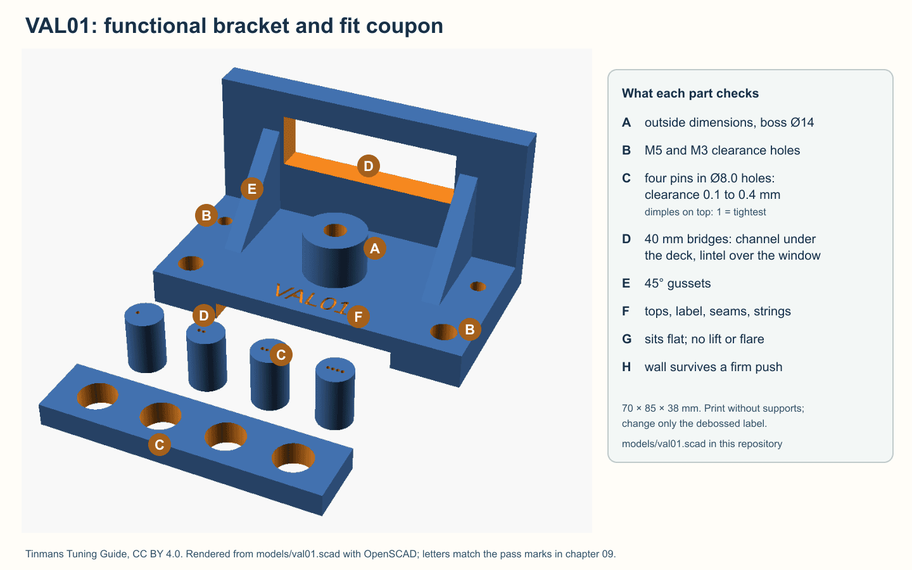

# Validation and Profile Release

> **At a glance**
> - **Decide:** whether the profile is finished
> - **Test:** a real part sliced fresh from the saved profile, checked against the pass marks
> - **Keep:** the candidate renamed `TUNED`, with a revision number and notes

A calibration value is not finished when its test looks good. A profile is
finished when the complete settings work together on representative parts and
the evidence can be reproduced.

## Minimum Validation Set

### 1. Broad surface coupon

Checks global and top-surface flow, line continuity, wall contact, and visible
surface defects.

### 2. Dimensional artifact

Checks X, Y, and Z scale, external contours, several hole sizes, elephant foot,
and at least one functional clearance.

Use more than one dimensional artifact when the symptom crosses categories. A
Benchy is a strong geometry-and-surface diagnostic but is not a substitute for
a multi-size dimensional stack, a multi-point XY/skew grid, or raw dial-gauge
motion verification. Preserve signed X and Y readings rather than reporting
only absolute error; opposite signs require an axis-specific investigation
before any global compensation is accepted.

### 3. Geometry artifact

For a Benchy, record the [official feature checks and nominal dimensions](24-benchy-inspection-and-measurement.md),
with local acceptance limits clearly separated from the source specifications.

Checks bridges, overhangs, small towers, text, curves, corners, and travel
stringing.

### 4. Representative production part

[VAL01](#val01-the-last-test-before-tuned) is the guide's standard functional
part for this step. Add your own production part as well when you have one.

Uses the actual layer height, wall strategy, infill, support, speed, chamber,
and build plate expected in service.

### 5. Mechanical specimen when needed

Validates layer adhesion or functional strength at the production temperature,
flow rate, cooling, orientation, and environmental conditioning.

## Acceptance Criteria

Define limits **before the first tuning print**, not at the end (see
[Step 0](00-how-to-use-this-guide.md#step-0-decide-what-good-enough-means)).
Revisit them here. Examples:

```text
No missing or discontinuous perimeter lines.
No open top-surface channels visible under diffuse light.
External dimensions within +/- 0.10 mm over 50 mm.
Specified pin passes the sliding-fit hole without force.
No corner lift greater than 0.20 mm.
No layer separation in the defined bend comparison.
```

Avoid criteria such as "looks good" without a reference or failure threshold.

## Confirm the Operating Envelope

Validate the profile at the edges that production will use:

- lowest and highest normal layer heights;
- slow external walls and fastest infill;
- short and long layers;
- small and large bed footprints;
- longest expected print duration;
- enclosure and ambient extremes;
- tool changes or material changes when applicable.

A single cube cannot validate all of these.

## Review the G-Code

Before a final release, inspect the sliced result for:

- selected physical tool and nozzle, not only the preset label;
- bed mesh and offset behavior;
- temperature transitions;
- fan commands and chamber behavior;
- PA or Linear Advance commands;
- flow and feature-specific overrides;
- actual volumetric-flow range;
- layer heights and line widths consistent with the installed nozzle;
- model scaling and compensation;
- unexpected auxiliary, fiber, or tool-change commands;
- unintended calibration-mode commands.

Where the machine exposes live state, compare the important emitted commands
with the effective firmware values after printing begins. The last writer wins;
an earlier start-G-code command can be replaced by a later slicer command.

For a networked multi-tool printer, extend this review to the complete job
lifecycle. Confirm the uploaded file path, perform a real home before launch,
and audit not only the start tool but every load, purge, cutter, tool-change,
and unload command through the end block. Then verify the remote printer's
active filename, selected tool, temperatures, PA, and job progress after it
starts. A control request timing out does not establish its outcome; live state
is the authoritative record.

## Name, Version and Promote

A profile name should tell you, at a glance in a drop-down list, whether it is
safe to print with and what it is for. The field runs settled on this pattern:

```text
Filament: STATUS - Machine - Nozzle - Brand Material - rNN
Process:  STATUS - Machine - Nozzle - Brand Material - Layer Purpose - rNN
```

For example:

```text
CANDIDATE - CORE One+ INDX 8T 0.4 HF - 3D-Fuel Pro PCTG - r7
TUNED - Qidi Plus4 - 0.6mm - Elegoo PET-CF - r14
TUNED - Qidi Plus4 - 0.6mm - Elegoo PET-CF - 0.24mm Production - r25
```

Use ` - ` (space, hyphen, space) between parts. Avoid `|`, `/`, `\`, `:`,
`*`, `?`, `"`, `<`, `>`, `[` and `]`: profiles are saved as files, and Windows
does not allow these characters in file names. Tinman on macOS accepts `|`,
but a profile named that way cannot be shared with a Windows machine.

Rules that kept the field runs honest:

- **Status.** `CANDIDATE` while any stage is open. `TUNED` only after the
  required stages and a representative part pass for that exact machine,
  nozzle and material. `RETIRED - DO NOT USE` for anything superseded that must
  stay visible.
- **A new revision for each accepted change.** When a test changes an accepted
  value, save a new revision (`r09 -> r10`) and note which value changed and
  why. When a test confirms the current values, **do not** make a new revision:
  one K2 run finished four confirming tests with no change and stayed at r10.
- **Filament and process counters are independent.** The recommended release is
  a pair, such as filament r14 with process r25, not "both at r14".
- **Promote the tested file unchanged.** `TUNED` is the last `CANDIDATE`
  renamed, with its values byte-for-byte the same and a note of the release
  date. If anything changes during promotion, it is a new candidate.
- **One current generation.** Keep one tuned filament per machine, nozzle and
  material, and one tuned process per layer height and purpose. Move older
  generations out of the active lists into a dated folder with a short note of
  what replaced them, so they can be restored.
- **Test values never reach a release.** Calibration tests leave unsaved test
  values in the presets (see
  [Running Tinman's Calibration Tests](25-running-tinman-calibrations.md#how-a-test-is-built));
  save only the one value the test chose.

Record with every revision:

- the parent printer and process profiles;
- slicer and firmware versions;
- accepted values and their experiment records;
- known limits and provisional values (for example "MVS not reached",
  "0.4 mm values inherited from 0.6 mm, not retested");
- date, author, and reason for change.

Keep tuned filament profiles machine-specific and restrict their compatibility
to the matching printer. Tinman can also scope a profile to one physical printer
and nozzle when you save it (**Printer scope**), so a profile tuned on one
machine does not appear for another. Preserve the generic or supplier profile
as an untouched reference.

A visually improved coupon is still a candidate. Promote it only after a clean
project reproduces the slice and a representative functional part passes its
dimensional, fit, surface, and strength requirements.

## VAL01: The Last Test Before TUNED

VAL01 is a functional bracket with a fit coupon. It is the last print before a
filament profile is called `TUNED`, on every printer and for every material.
Each calibration print tests one thing. VAL01 tests everything together, on a
part that has to work.



### When and Why to Run It

Run VAL01 after chapters 01–08 have chosen their values, with the exact
filament and process pair you intend to release. Slice it fresh from the saved
profiles, with no project-only changes, no object overrides and no supports:
the bridges are part of the test.

It was designed during the guide's tuning runs, on a CORE One+ INDX with PCTG
in November 2026. The profile there had passed every calibration test, but
nothing had yet shown that the values worked together on a real part. The
bracket puts the risky features of a typical functional print side by side:

- two 40 mm bridges, one of them under a solid deck that carries a boss (the
  layout that left craters on bridge decks in an earlier cooling test);
- 45° gussets;
- clearance holes for M5 and M3 screws;
- pins with 0.1 to 0.4 mm of clearance in 8 mm holes;
- flat tops with debossed text, seams, and a base that must sit flat;
- a tall wall that must not split.

Run it again as a regression check after a nozzle, hotend, firmware or slicer
change, when the profile is meant to stay `TUNED`.

### The Model

Download [models/val01.scad](../models/val01.scad) (OpenSCAD source) or
[models/val01.stl](../models/val01.stl) (labelled "VAL01"). The part is
70 × 85 × 38 mm.

- **Bracket:** a 70 × 40 × 8 mm base with a cable channel underneath, 40 mm
  wide and 4 mm tall, open at the front. That makes a 40 mm bridge with a 4 mm
  solid deck on top. An upright wall, 6 mm thick and 38 mm tall overall, has a
  40 × 12 mm window, which makes a 40 mm lintel bridge. Two 45° gussets, a
  Ø14 mm boss with a Ø5 mm bore standing on the bridge deck, two Ø5.5 mm (M5
  clearance) holes, two Ø3.4 mm (M3 clearance) holes, and a debossed label.
- **Fit coupon:** a plate with four Ø8.0 mm holes, and four 12 mm pins of
  Ø7.9, 7.8, 7.7 and 7.6 mm. Each pin carries 1 to 4 dimples on top: one
  dimple is the tightest (Ø7.9), four the loosest (Ø7.6).

Change only the label (`label` at the top of the `.scad` file), to the
material and revision under test. Print at the profile's own layer height, on
the plate it will be used with.

### Pass Marks

Let the part cool for at least 30 minutes. Measure as for the dimensional
tests: at mid-side, on the upper half of walls, away from seams.

| # | Check | Pass if |
| --- | --- | --- |
| A | Bracket outside dimensions | base length 70.00 ± 0.15 mm; depth 40.00 ± 0.10 mm; wall thickness 6.00 ± 0.10 mm; boss Ø14.00 ± 0.15 mm; overall height 38.00 ± 0.10 mm |
| B | Clearance holes | an M5 screw (or a 5 mm drill shank) passes both Ø5.5 holes freely; an M3 screw passes both Ø3.4 holes freely. Record the boss bore (Ø5.0 nominal). |
| C | Fit coupon | at least the 3-dimple pin (Ø7.7, 0.3 mm clearance) slides fully through its hole by hand without force. Record the tightest pin that slides. |
| D | Bridges | channel underside: continuous strands, none dropped, sag at mid-span no more than about 0.5 mm. Deck top, text and boss: no crater, hole or lifted strand. Lintel underside continuous. |
| E | Overhangs | the 45° gusset faces are clean, with no curl or droop |
| F | Surfaces | tops closed with no open channels; no rows of beads along top edges; the label legible; seams narrow; at most fine hairs of stringing |
| G | First layer and warp | sits flat on a flat surface without rocking; no corner lift over 0.2 mm; no bottom flare that stops a straight edge sitting flat |
| H | Layer adhesion | the wall survives a firm thumb push at its top, toward the front, with no crack or delamination. If you break a pin, it bends before it breaks. |

These limits were set for PCTG on a 0.4 mm nozzle. If a material needs a
different limit (a flexible or high-shrink material, a larger nozzle), write the
new limit and the reason in the experiment log **before** printing.

The tightest pin that slides (criterion C) is worth keeping: it is the
sliding-fit allowance for this material, nozzle and profile, and it is the
number to use when you design parts. Expect small round holes to print slightly
small and small round parts slightly large. In the first run's dimension tests,
8 mm holes came out about 0.05 mm under size.

### If a Check Fails

Go back to the chapter that owns the defect, change one variable, and print
VAL01 again.

| Failed | Go back to |
| --- | --- |
| A | [Dimensional accuracy](07-dimensional-accuracy.md): shrinkage or contour compensation |
| B, C | [Dimensional accuracy](07-dimensional-accuracy.md#holes-and-fits): holes, polyholes, design allowance |
| D | [Bridges](06-cooling-and-retraction.md#bridge-controls); for craters on the deck, try **Extra bridge layers** |
| E | [Cooling](06-cooling-and-retraction.md#cooling-test-method): overhang fan |
| F | [Flow ratio](05-flow-ratio.md), [top surfaces](08-seams-and-surfaces.md#top-and-bottom-surfaces), [retraction](06-cooling-and-retraction.md#retraction-test) |
| G | [Foundations](01-foundations.md): first layer and plate; warping materials in [material families](10-material-families.md) |
| H | [Temperature and the bond check](02-conditioning-and-temperature.md#a-simple-bond-check); normal fan in [cooling](06-cooling-and-retraction.md) |

A profile becomes `TUNED` only when every check passes, plus whatever sign-off
your own process requires. Record the result, the measurements and the
tightest sliding pin in the profile's notes.

The first VAL01 was printed on a CORE One+ INDX with 3D-Fuel Pro PCTG on
2026-11-21; its result was still pending when this edition was written.

## Tuning Prints and Validation Prints


Tuning prints are printed **without supports**, so that supports do not hide or
cause the defect being tuned. Validation prints are printed the way production
will print them, **with supports** where the part needs them. Support settings
are then tuned on the validation part, not on coupons. A PET-CF run's
support-interface lessons are in [Worked Examples](26-worked-examples.md).

## Regression Triggers

Run at least a short confirmation after:

- changing nozzle, hotend, extruder, or cooling duct;
- updating firmware or slicer behavior;
- switching material color, formulation, or lot;
- changing temperature, MVS, or PA materially;
- changing enclosure or chamber operation;
- observing a sudden quality change from a previously stable profile.

## Release Decision

Use the [profile release checklist](../templates/profile-release-checklist.md).
A released profile should state what it is optimized for: visual quality,
balanced use, speed, strength, dimensional work, or a specific process. One
profile does not need to win every tradeoff.
