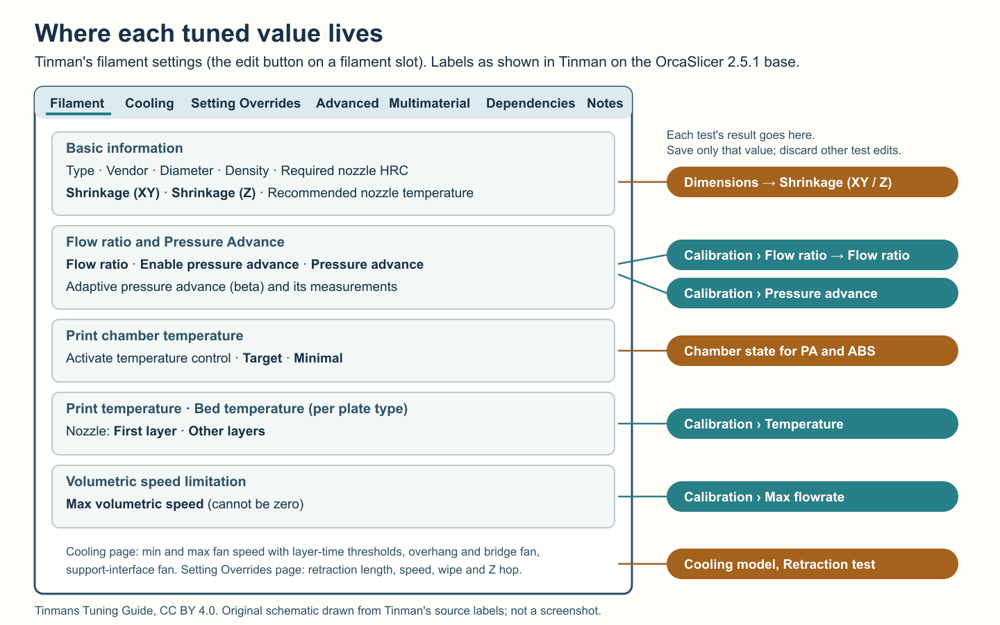

# Filament and Printer Settings

> **At a glance**
> - **Decide:** where a value belongs: printer, filament or process
> - **Test:** the identity, temperature and machine-contract sections
> - **Keep:** hardware facts in the printer profile, material facts in the filament

Machine settings describe installed hardware and firmware. Filament settings
describe how one material behaves on that hardware. Verify the resolved machine,
tool, nozzle, filament, and process together before changing a value. See the
[identity gate](20-profile-integrity-and-experimental-resets.md).

## Filament Identity and Physical Properties

Material type and vendor identify the profile and may affect compatibility and
loading behavior. Display color helps identify a spool; it does not measure its
formulation. Diameter and density affect extrusion calculations and mass
estimates. Price affects estimates, not the deposited path. Enter manufacturer
data and measurements rather than adjusting these fields to conceal a flow
problem.

Required nozzle hardness is a compatibility limit for abrasive materials.
Support-material and soluble-material flags describe the filament's role; they
do not establish that two materials bond well enough for a particular support
interface. Softening temperature and idle temperature affect standby behavior.
Keep them consistent with the material and the printer's loading procedure.

Use [dimensional accuracy](07-dimensional-accuracy.md) for XY/Z shrinkage. Scale
compensation and extrusion flow solve different error models.

## Nozzle, Bed, and Chamber Temperatures

Tune nozzle temperature with conditioned filament at a known flow demand. Bed
temperature is plate- and material-specific. Initial-layer and later-layer
values have different roles. An active chamber target requires compatible
hardware, firmware, and start G-code; a saved number alone does not prove the
chamber reaches that target.

In Tinman the chamber fields are on **Filament > Print chamber temperature**:
**Activate temperature control**, a **Target**, and a **Minimal** temperature.
What they do depends on the printer's start G-code. On one printer a non-zero
minimal temperature makes the start code hold the bed hot until the chamber
warms; on another the "chamber control" only runs fans to cool the chamber
toward the target, because the printer has no chamber heater.

The printer can also act on its own. A Prusa CORE One+ opened its top vent at
the start of every print because the printer's *own* filament entry for that
material had a low chamber target, whatever the slicer sent; its chamber fans
then started partway through a print and changed the pressure-advance reading
(see [Pressure Advance](04-pressure-advance.md#the-chamber-changes-pa)).
Check the printer's own filament and chamber settings, not only the slicer's.

On multi-material plates, many printer profiles set the bed from the hottest
filament used. Check the bed temperature the G-code actually uses.

Judge adhesion, distortion, extrusion consistency, and strength together. Keep
temperatures within the material and hardware limits. Follow
[conditioning and temperature](02-conditioning-and-temperature.md) before
[maximum volumetric flow](03-volumetric-flow.md),
[pressure advance](04-pressure-advance.md), and [flow ratio](05-flow-ratio.md).

## Loading, Unloading, and Multimaterial

Loading speed, unloading speed, ramming volume, cooling moves, stamping, and
delay fields describe the physical feeder and melt-zone sequence. Incorrect
values can leave a poor filament tip or interfere with a tool change. Begin
with a known-compatible machine procedure and change one phase only when the
observed failure identifies it.

Use [multimaterial](16-multimaterial-tab.md) for purge towers, flush routing,
feature assignments, and interlocking. Check the actual tool/slot mapping and
material pair in the final executable job. A filament profile cannot repair an
incorrect physical tool assignment.

## Build Volume and Machine Identity

Printable area, origin, maximum height, exclusions, and bed shape define the
machine's usable coordinate space. Copy them from the verified machine
specification. A model fitting the drawn plate does not prove the carriage or
accessories have clearance. Printer model, variant, nozzle size, and connection
identity must refer to the same physical machine.

## Nozzle and Extruder Contract

Nozzle diameter describes installed hardware. Minimum and maximum layer height
bound available layer planning. Extruder offsets describe the tool coordinate
relationship. Filament diameter belongs to the corresponding material/tool.
Do not change these to compensate for a dimensional or flow error elsewhere.

Retraction, wipe, Z hop, lift conditions, and travel behavior depend on the
hotend, extruder, material, and geometry. Use
[cooling and retraction](06-cooling-and-retraction.md). Firmware retraction
requires the correct firmware command support and configuration.

## Firmware and G-code

Firmware flavor determines emitted command conventions. Relative/absolute
extrusion, arc support, acceleration commands, and machine-limit usage must
agree with the controller. Start, end, pause, layer-change, and tool-change
scripts can override temperatures, flow, pressure advance, tools, or homing.

Inspect the entire final G-code and macro chain. An apparently correct preset
is insufficient when startup changes it. Preserve a working script before
editing; assess the actual machine behavior separately from a successful slice.

## Fans and Air Filtration

Part-cooling, auxiliary, chamber, and filtration fans serve different purposes.
Verify the actual fan mapping before changing control fields. Fan speed-up time
and kick-start behavior describe response and reliable starting, not the ideal
cooling percentage for every material. Use the
[cooling procedure](06-cooling-and-retraction.md) for print-quality decisions.

## Clearance and Sequential Printing

Extruder radius, rod/gantry height, printable exclusions, and object spacing
constrain printing objects sequentially. Use measured hardware clearance,
including toolheads, ducts, probes, and accessories. Inspect the sequence and
collision preview; changing a clearance field does not move the hardware.

## Bed Mesh and First-Layer Baseline

Adaptive-mesh settings must match the firmware's probing contract, coordinates,
and start macros. Verify the active tool/probe, mesh area, offsets, and first
layer before tuning extrusion. See [foundations](01-foundations.md). Do not use
flow or temperature changes to hide a probing or Z-reference error.

## Accessories and Tool Changes

Set nozzle count, feeder type, tool-change mode, offsets, and accessory flags
for the installed machine. Preserve machine-specific docking, cutting, wiping,
and loading contracts. Verify every tool used by startup, calibration, purge,
and printing, even when the model itself uses only one tool.

## Notes and Profile Dependencies

Record the exact machine/nozzle/material scope, provisional and accepted
values, passed stages, remaining tests, and validation evidence. Compatibility
and inheritance determine which profile appears and what values it resolves.
Keep a recoverable mapping when retiring an old preset. Follow the
[release checklist](../templates/profile-release-checklist.md).
