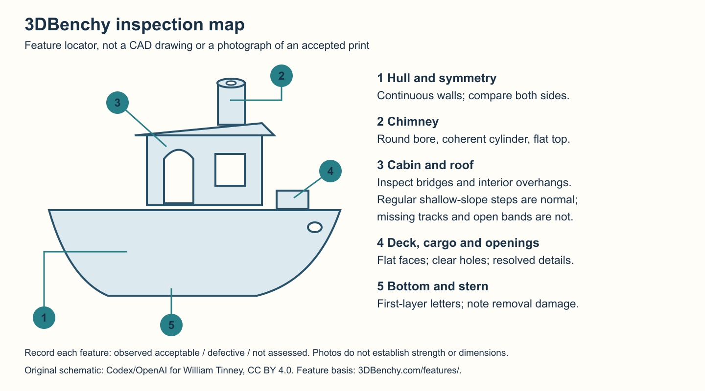
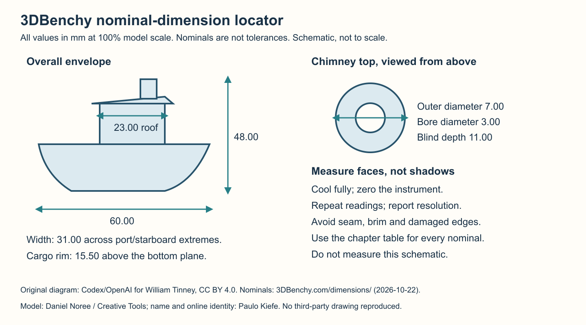

# 3DBenchy: Official References and Evidence-Based Grading

Source review: 2026-10-22. This chapter uses the original single-part
#3DBenchy by Creative Tools, designed by Daniel Noree. Official references:
[features](https://www.3dbenchy.com/features/),
[dimensions](https://www.3dbenchy.com/dimensions/), and
[generic print settings](https://www.3dbenchy.com/3d-print/).

## What Is Official, and What Is a Local Decision?

Those official pages describe inspection features, nominal geometry, and
generic settings. They do not specify a numerical score, letter grade, or
universal pass/fail dimensional tolerance. Do not invent an official score or
present this guide's acceptance thresholds as Creative Tools requirements.
Report each feature as observed acceptable, defective, or not assessed;
define application-specific limits before a comparison.

A completed boat is evidence of completion, not proof of calibration, strength,
or production qualification. Photos cannot establish dimensions or layer
strength. A Benchy also cannot replace multi-size dimensional or raw-motion
metrology.

## Benchmark Identity and Comparability

Use the original model at 100% scale without supports. The official generic
FFF example uses a 0.4 mm nozzle, 0.2 mm layers, 10% infill, extrusion speeds
up to 50 mm/s, and travel up to 150 mm/s. These are reference conditions, not
mandatory settings for every material or permission to exceed machine limits.

Record nozzle, layer geometry, infill, orientation, brim, material condition,
temperatures, cooling, layer-time slowdown, speed/MVS, and final G-code hash.
A 0.6 mm nozzle or different layer height remains useful for diagnosis, but
must not be called a like-for-like reproduction of that reference setup.
Keep conditions matched when comparing boats. Speed-contest rules are a
separate protocol, not a substitute for quality inspection.

## Official Feature Checks

| Feature | Inspect on the fully cooled boat |
| --- | --- |
| Curved hull | Uneven texture, discontinuous tracks, and overhang distortion |
| Symmetry | Side-to-side skew or warp; confirm with aligned views/metrology |
| Deck, cargo rim, chimney top | Flatness and parallelism to the base |
| Chimney | Concentric bore and outer cylinder; roundness and continuity |
| Cabin openings/interior | Bridge sag, loose strands, and overhang definition |
| Roof and gunwale | Shallow slopes reveal expected layer steps; distinguish these from holes or irregular deposition |
| Rear window, bow holes, rod holder | Opening fidelity, flanges, and obstruction |
| Stern lettering | Tiny-detail readability; separate nozzle-resolution limits from broad wall defects |
| Bottom lettering | First-layer compression and line joining; distinguish removal damage |

These checks paraphrase the official feature descriptions. Deep open bands,
missing perimeter segments, or a distorted chimney are not explained merely
by normal shallow-roof stair stepping.

<!-- pdf:page-break-before -->

## Official Nominal Dimensions at 100% Scale

All linear values below are millimeters. They are nominal design values,
not tolerances. Use the official linked drawings to locate measurement faces.

| Item | Nominal |
| --- | --- |
| Overall length / width / height | 60.00 / 31.00 / 48.00 |
| Roof front-to-rear faces | 23.00 |
| Chimney bore / top outside diameter / blind depth | 3.00 / 7.00 / 11.00 |
| Cargo rim height above base | 15.50 |
| Cargo outside / inside / depth | 12.00 x 10.81 / 8.00 x 7.00 / 9.00 |
| Bow hawsepipe bore / flange depth | 4.00 / 0.30 |
| Front rectangular window | 10.50 x 9.50 |
| Rear window bore / outside / flange depth | 9.00 / 12.00 / 0.30 |
| Stern sign and lettering relief | 0.10 |
| Bow overhang / roof slope, relative to horizontal | 40 degrees / 5.5 degrees |

Measure after full cooling with a zero-checked instrument. Record readings,
resolution, repeatability, signed error (measured minus nominal), and any
access or removal-damage limitation. Do not read dimensions from an
unscaled photograph, infer printed height from final G-code Z, or apply
shrinkage/axis compensation to hide unstable extrusion.

## Reusable Grading Record

For each row, save: feature, photo/measurement, observation, local criterion,
result, uncertainty, and next diagnostic action. Separate:

- **Visual quality:** surface continuity, geometry, bridges, detail, and base.
- **Measured accuracy:** actual readings versus nominal, not guessed passes.
- **Mechanical performance:** separately controlled functional/instrumented
  evidence when required; appearance alone is insufficient.

For this guide's foundation gate, tolerate ordinary layer texture and finite
nozzle resolution, but do not accept obvious missing tracks or gross geometry
failure. Preserve the failed boat and inspect the exact emitted commands and
available telemetry at the affected heights. Stable reported temperature does
not prove stable melt delivery; an upstream diameter reading is not an
extrusion-volume measurement. Check conditioning and machine/deposition
repeatability before cosmetic tuning. Change one causal variable in the
smallest justified diagnostic, not several values to improve a score.

This is a triage route, not a new mandatory Benchy stage or a requirement for
a cosmetically perfect boat before temperature tuning. Use
[Foundations](01-foundations.md), the [diagnostic matrix](diagnostic-matrix.md),
and the earliest affected prerequisite. Later dimensional, surface, and
representative validation stages still require their own evidence.

<!-- pdf:page-break-before -->

## Photographed Foundation Failure: Do Not Grade by Completion Alone

The photographed boat completed on a Qidi Plus4 with a Micro Swiss CM2
0.6 mm nozzle, 0.24 mm body layers, 0.30 mm first layer, 275 C nozzle,
100 C bed, 50 C chamber target, flow 1.00, PA 0 and a 3 mm3/s diagnostic
volumetric cap. These are recorded experimental conditions, not recommended
settings or an accepted tune. Other views of this specimen show hull and
opening irregularities as well.

The chimney's deep discontinuities and malformed rim are different from the
regular layer steps expected on the shallow roof. The local foundation result
is **defective**, not an official numerical grade. Dimensions, internal
bonding and load capacity remain **not assessed**. Neither this image nor a
stable reported nozzle temperature identifies moisture, a clog, or incorrect
flow as the cause. Consult the diagnostic matrix and audit the affected paths
before choosing a one-variable comparison.

## Figure and Model Attribution

The inspection and dimension locators are original explanatory schematics,
not copies of the official website's drawings and not replacement CAD/STL
files. Editable SVG sources and publication PNGs are retained in `assets`.
The field photograph was made and supplied by William Tinney; publication
conversion removes device/location metadata without altering the specimen.

Daniel Noree designed #3DBenchy while at Creative Tools. Paulo Kiefe named it
and established its online identity. The official [license and attribution
page](https://www.3dbenchy.com/license/) identifies the model as CC0 1.0.
That model license is not assumed to license every website illustration.
Original guide diagrams, text and contributed photographs are distributed
under this repository's CC BY 4.0 license; source creators retain their own
rights. No endorsement is implied.
